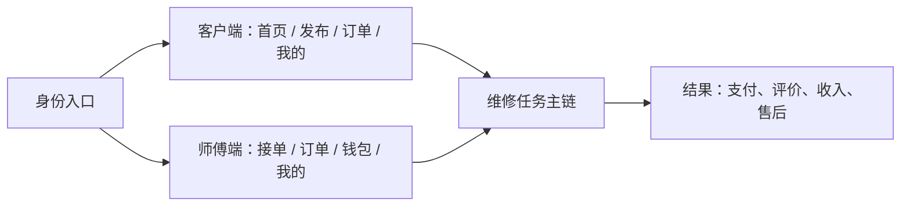
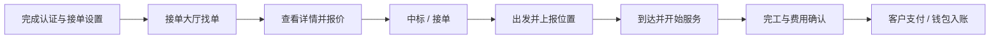

# 自家人居家维修小程序 · 功能与交互文档

> 版本：v6.2
> 更新日期：2026-08-03
> 对应 PRD：v6.2（兼容路径：`../../PRD_v6.0.md`）
> 设计系统：Glass Neumorphism Fusion（玻璃新拟态融合）
> 文档职责：定义功能入口、用户行为、状态、返回与异常恢复；业务范围以 PRD 为准，视觉参数以样式规范为准

---

## 目录

0. [先读：产品使用逻辑总览](#sec-0)
1. [一、交互设计原则](#sec-1)
2. [二、全局交互规范](#sec-2)
3. [三、客户端核心功能交互](#sec-3)
4. [四、师傅端核心功能交互](#sec-4)
5. [五、组件交互状态](#sec-5)
6. [六、动效交互规范](#sec-6)
7. [七、异常状态与反馈](#sec-7)
8. [八、手势与操作习惯](#sec-8)
9. [九、操作结果全量对照表](#sec-9)
10. [十、统一任务状态模型](#sec-10)
11. [十一、异步提交与防重复](#sec-11)
12. [十二、权限、网络与中断恢复](#sec-12)
13. [十三、表单保护与高风险操作](#sec-13)
14. [十四、数据刷新、消息与多端一致性](#sec-14)
15. [十五、埋点与交互验收](#sec-15)
16. [十六、双端信息架构与全功能入口](#sec-16)
17. [十七、核心任务主路径与状态下一步](#sec-17)
18. [十八、功能可发现性与易用性规则](#sec-18)

---

# 先读：产品使用逻辑总览

本产品不是“页面集合”，而是围绕一次维修任务展开的双端协作系统。任何页面都应帮助用户回答三个问题：**我现在在哪、当前发生了什么、下一步该做什么。**

| 角色 | 核心心智模型 | 主路径 |
|------|--------------|--------|
| 客户 | 找到解决办法，并放心完成一次维修 | 找服务/问 AI → 发布需求 → 选择报价 → 等待上门 → 服务 → 支付 → 评价/售后 |
| 师傅 | 找到合适订单，并顺利完成服务和收款 | 完成准入 → 找单 → 报价 → 出发 → 到达 → 服务 → 完工 → 收款/经营 |

全局遵循两条使用原则：

1. **稳定入口**：每项功能至少归属于一个固定功能中心，用户不依赖消息推送或偶然入口也能再次找到。
2. **当前任务优先**：进行中的订单、待支付、待评价、待处理认证等事项，必须在对应首页或 Tab 首屏直接呈现下一步操作。

> 第九章用于查询单页元素行为；第十至十五章定义通用状态和异常；第十六至十八章定义用户如何找到并顺利完成所有功能。发生冲突时，以第十六至十八章的导航和使用逻辑为准。

---

# 一、交互设计原则

## 1.1 核心原则

**触感优先、层级分明、反馈即时、路径最短。**

- **触感优先**：所有可点击元素通过新拟态凸起/凹陷营造"可按压"的视觉暗示，让用户在触摸前就知道哪里可以操作。
- **层级分明**：玻璃材质 + 新拟态阴影 + 渐变光斑构建三维层次，重要信息浮起，次要信息下沉。
- **反馈即时**：每一次操作都有即时视觉反馈（按下凹陷、缩放回弹、颜色变化）。
- **路径最短**：核心操作（发布需求、支付、评价）不超过 3 步完成。

## 1.2 交互一致性

| 维度 | 规则 |
|------|------|
| 导航返回 | 左上角返回按钮 +  iOS 右滑返回 |
| 列表刷新 | 下拉刷新（回弹动画） |
| 加载状态 | 骨架屏 + 脉冲动画 |
| 空状态 | 插画 + 文字说明 + 操作按钮 |
| 错误提示 | 顶部 Toast / 底部 Snackbar / 弹窗确认 |
| 确认操作 | 重要操作（取消订单、删除、退款）需要二次确认 |

---

# 二、全局交互规范

## 2.1 页面导航

### 底部 Tab Bar 交互

- **切换动画**：点击 Tab 时图标轻微放大（1.1x）+ 玻璃胶囊横移过渡（200ms spring）
- **活跃态**：Liquid Glass 玻璃胶囊包裹图标 + 文字，品牌色渐变
- **中间发布按钮**：凸起新拟态 + 品牌渐变，点击时上浮 + 缩放回弹

### 顶部导航栏交互

- **返回按钮**：新拟态凸起圆形，按下凹陷 + 缩放 0.94
- **标题居中**：17px 粗体衬线字体
- **右侧操作**：图标按钮，最多 2 个，超出收纳到「更多」

### 页面转场

| 转场类型 | 触发场景 | 动画效果 |
|---------|---------|---------|
| 推入 | 点击列表项进入详情 | 从右侧滑入（250ms ease-out） |
| 弹出 | 返回上一级 | 向右侧滑出（200ms ease-in） |
| 模态弹出 | 支付、选择器、确认弹窗 | 从底部滑上 + 背景遮罩淡入（300ms spring） |
| 全屏覆盖 | 登录页、发布流程 | 从底部全屏滑上（350ms spring） |

## 2.2 按钮交互

### 按压反馈（所有按钮统一）

- **按下态**：新拟态内凹阴影 + 缩放至 0.94 + 颜色微调
- **释放态**：恢复凸起阴影 + 回弹至原始大小（spring 动画）
- **禁用态**：灰度 50% + 无阴影 + 不可点击光标

### 按钮类型与使用场景

| 按钮类型 | 视觉特征 | 使用场景 |
|---------|---------|---------|
| 主按钮（渐变 CTA） | 品牌渐变 + 辉光阴影 | 底部确认操作、重要 CTA |
| 主按钮（实色） | 品牌实色 + 新拟态凸起 | 卡片内主要操作 |
| 次按钮 | 半透明白 + 玻璃边框 | 次要操作、辅助选择 |
| 幽灵按钮 | 透明 + 细边框 | 标签、次要选项 |
| 圆形图标按钮 | 新拟态凸起圆形 | 导航、操作栏 |
| 胶囊标签按钮 | 凸起 / 凹陷切换 | 筛选、选择器 |

## 2.3 列表交互

### 列表项操作

- **点击反馈**：按下时卡片轻微下沉（阴影减小 + 缩放 0.98）
- **左滑操作**：删除、更多（仅列表页支持）
- **右滑操作**：返回上一级（全局）
- **长按**：唤起上下文菜单（收藏、分享等）

### 下拉刷新

- 下拉距离 < 60px：显示加载指示器（品牌色旋转圆环）
- 下拉距离 >= 60px：松手触发刷新，指示器回弹至 40px 位置旋转
- 刷新完成：指示器收起 + 内容区轻微弹动

### 加载更多

- 滚动到底部前 50px 触发加载
- 加载状态：底部显示加载动画 + "加载中..."
- 无更多数据：显示 "— 没有更多了 —"

## 2.4 表单交互

### 输入框

- **默认态**：新拟态内凹 + 占位符文字
- **聚焦态**：内凹加深 + 品牌色细边框辉光
- **输入中**：实时校验，右侧显示清除按钮（×）
- **错误态**：红色边框 + 错误提示文字
- **禁用态**：灰度 + 降低透明度

### 选择器

- **单选**：圆形 radio，选中态品牌色填充 + 白色圆点
- **多选**：方形 checkbox，选中态品牌色 + 对勾
- **开关**：胶囊形 toggle，滑杆动画（spring）
- **标签选择**：chip 凸起/凹陷切换

### 弹窗与选择器

| 组件 | 触发方式 | 交互动效 |
|------|---------|---------|
| 底部选择器 | 点击选择项 | 从底部滑上，背景遮罩淡入 |
| 确认弹窗 | 重要操作前 | 中心缩放弹出 + 背景模糊 |
| 操作菜单 | 长按 / 更多按钮 | 气泡弹出 + 三角形指示器 |
| Toast 提示 | 操作反馈 | 顶部滑入，2秒后自动消失 |

---

# 三、客户端核心功能交互

## 3.1 首页交互

### 入口分布

| 区域 | 元素 | 点击结果 |
|------|------|---------|
| 顶部导航 | 定位城市 | 切换城市 / 选择地址 |
| 顶部导航 | 消息图标 | 进入消息中心 |
| 搜索栏 | 搜索框 | 进入搜索页 |
| 服务宫格 | 服务图标（8个） | 进入对应服务列表页 |
| AI 助手卡 | 整张卡片 | 进入 AI 对话页 |
| 订单快捷入口 | 待接单 / 进行中 / 待支付 / 待评价 | 进入对应状态订单列表 |
| 推荐师傅 | 师傅卡片 | 进入师傅详情页 |
| 活动 Banner | Banner 图 | 进入活动页 / H5 |
| 底部 Tab | 首页 / 发布 / 订单 / 我的 | 切换 Tab |

### 滚动交互

- 上滑时顶部导航栏逐渐由透明过渡为实色渐变背景
- 下滑时导航栏恢复透明
- 服务宫格区域可横向滚动查看更多分类

## 3.2 发布需求流程

### 步骤切换

- 共 3 步：服务与问题 → 地址与时间 → 报价与确认
- 顶部进度指示条，每完成一步填充一段
- 支持点击已完成步骤回退修改
- 「下一步」按钮固定在底部

### 各步骤交互细节

**第一步 - 服务与问题**
- 4 列网格布局，图标凸起新拟态
- 点击服务类型只完成选择，不自动跳步，用户可继续描述问题
- 支持顶部搜索服务名称
- 输入框新拟态内凹，聚焦时加深凹陷
- 图片上传：点击 + 号从相册/拍照选择，最多 6 张
- 图片支持预览、删除（右上角 ×）
- 紧急程度开关：胶囊 toggle；开启后显示服务端返回的本次 `+¥X / +X%` 与计价说明，不硬编码比例

**第二步 - 地址与时间**
- 地址选择：点击调起微信地图选点
- 时间选择：今天 / 明天 / 指定日期 + 时间段选择器
- 联系人 + 手机号：自动填充已保存信息，可编辑

**第三步 - 报价与确认**
- 显示订单摘要：服务类型、问题描述、时间、地址、费用预估
- v6.2 正式流程仅启用“师傅竞价”：发布后由多位师傅报价，用户再选择；一口价、悬赏和指定师傅在状态、价格与兜底规则完整前不出现在生产入口
- 底部固定「发布需求」按钮
- 发布成功：弹出成功动画 → 跳转订单详情页

## 3.3 订单状态流转交互

### 状态切换触发

| 当前状态 | 用户操作 | 结果 | 反馈 |
|---------|---------|------|------|
| 待接单 | 点击「取消订单」 | 订单取消 | 二次确认弹窗 → 成功 Toast |
| 待接单 | 点击「查看竞价」 | 进入报价列表页 | 右推入 |
| 待接单 | 选择师傅 → 确认 | 变为已接单 | 成功弹窗 + 状态卡片刷新 |
| 已接单 | 点击「取消订单」 | 申请取消 | 二次确认 → 等待师傅确认 |
| 出发中 | 点击「查看位置」 | 进入实时追踪页 | 右推入 |
| 出发中 | 点击「联系师傅」 | 拨打电话 / 发消息 | 底部选择器 |
| 已到达 | 查看“师傅已到达”提示 | 等待师傅点击“开始服务”；位置不符时可反馈 | 状态提示 + 异常反馈入口 |
| 待支付 | 点击「立即支付」 | 进入支付页 | 底部弹出支付面板 |
| 待评价 | 点击「去评价」 | 进入评价页 | 右推入 |

### 实时追踪页交互

- **地图区域**：
  - 双指缩放、单指拖动
  - 师傅标记：呼吸脉冲动画（绿色）
  - 「跟随」按钮：开启后地图自动跟随师傅位置
  - 点击师傅标记：弹出师傅信息气泡
- **底部信息卡**：
  - 可上滑展开查看更多（时间线详情）
  - 下滑收起
  - 电话 / 导航 / 消息按钮横向排列
- **时间线**：
  - 已完成节点：绿色实心 + 对勾
  - 当前节点：品牌色 + 脉冲动画
  - 未完成节点：灰色空心

## 3.4 支付流程交互

### 支付页操作

1. 进入支付页：从底部滑上（模态）
2. 金额展示：数字渐入动画（从 0 滚动到目标金额）
3. 支付方式选择：
   - 点击支付方式卡片：选中态边框高亮 + 右侧圆点填充
   - 切换时轻微缩放反馈
4. 优惠券选择：
   - 点击进入优惠券选择页
   - 选择后返回，金额实时更新
5. 点击「立即支付」：
   - 按钮 loading 状态（旋转图标）
   - 按服务端返回的可用渠道调起微信支付、余额支付或组合支付；线下支付仅对后台明确允许的订单显示
   - 支付成功：成功动画 → 自动跳转订单详情
   - 支付失败：错误提示 + 重试按钮

### 支付安全

- 微信支付的密码 / 指纹 / 面容识别由微信支付提供；余额支付按平台安全策略验证
- 支付中禁止重复点击（按钮置灰 + loading）

## 3.5 评价流程交互

### 评价页操作

1. **星级评分**：
   - 从左到右滑动 / 点击选择星级
   - 星星填充动画（琥珀色）
   - 下方显示对应评价文字（非常不满意 → 非常满意）
2. **标签选择**：
   - 多选 chip 标签
   - 选中态：品牌色实底 + 白色文字 + 凹陷阴影
   - 未选中：凸起新拟态
3. **文字评价**：
   - 凹陷输入框，最多 500 字
   - 右下角实时字数统计
4. **图片上传**：
   - 最多 6 张，网格排列
   - 点击 + 号选择图片
   - 图片右上角删除按钮
5. **匿名评价**：
   - 胶囊开关 toggle
   - 开启后头像昵称隐藏
6. **提交**：
   - 底部固定提交按钮
   - 提交成功：成功动画 → 返回订单详情

## 3.6 个人中心交互

### 我的页面

| 区域 | 元素 | 点击结果 |
|------|------|---------|
| 顶部用户区 | 头像 / 昵称 | 未登录 → 登录页；已登录 → 个人资料 |
| 用户区右侧 | 设置图标 | 进入设置页 |
| 数据栏 | 订单数 / 优惠券 / 积分 / 收藏 | 点击各模块跳转对应页 |
| 会员入口 | 会员卡片 | 进入会员中心 |
| 年卡入口 | 年卡卡片 | 进入家庭年卡页 |
| 钱包入口 | 钱包卡片 | 进入我的钱包 |
| 功能列表 | 地址管理 | 地址列表页 |
| 功能列表 | 保险理赔 | 保险理赔页 |
| 功能列表 | 邀请奖励 | 邀请奖励页 |
| 功能列表 | 在线客服 | 客服聊天页 |
| 功能列表 | 意见反馈 | 反馈提交页 |
| 功能列表 | 关于我们 | 关于页 |

### 积分中心交互

- **签到**：点击签到按钮 → 成功弹窗 + 积分增加动画（数字滚动）
- **连续签到**：显示 7 天签到日历，已签到打勾
- **赚积分任务**：点击任务项 → 跳转对应页面完成任务
- **积分兑换**：点击商品 → 确认兑换弹窗 → 成功动画
- **积分明细**：Tab 切换（全部 / 获取 / 使用），列表下拉加载更多

### 邀请奖励交互

- **分享方式**：微信好友 / 朋友圈 / QQ / 复制链接
- **邀请码**：点击「复制」→ Toast 提示 "复制成功"
- **邀请记录**：列表展示，状态区分（已完成 / 待首单）
- **活动规则**：可展开/收起的规则列表

## 3.7 客服聊天交互

### 消息类型

| 消息类型 | 展示方式 | 交互 |
|---------|---------|------|
| 文字消息 | 气泡展示 | 长按复制 |
| 图片消息 | 缩略图气泡 | 点击放大预览 |
| 订单卡片 | 嵌入订单信息卡 | 点击跳转订单详情 |
| 快捷回复 | 气泡下方标签行 | 点击直接发送对应内容 |
| 满意度评价 | 星级 + 标签 | 点击提交评价 |

### 输入栏交互

- **语音切换**：左侧语音按钮，点击切换语音/键盘输入
- **表情**：表情面板从底部滑上
- **更多（+）**：展开更多功能（图片 / 拍照 / 订单 / 位置）
- **发送按钮**：输入文字后出现，品牌渐变圆形
- **输入中**：客服端显示 "对方正在输入..."

### 会话状态

- 客服在线：顶部显示绿色圆点 + "在线"
- 客服离线：显示 "当前非工作时间，留言后将尽快回复"
- 未读消息：首页消息图标红点 + 数字角标

---

# 四、师傅端核心功能交互

## 4.1 接单大厅

- 订单卡片列表，下拉刷新，上滑加载更多
- 订单筛选：服务类型 / 距离 / 价格区间
- 点击订单卡片 → 订单详情页
- 右下角「提交报价」按钮 → 报价弹窗；提交后等待用户选择，不代表已接单

## 4.2 服务流程操作

| 状态 | 操作按钮 | 交互反馈 |
|------|---------|---------|
| 已接单 | 「出发」 | 确认弹窗 → 位置上报启动 → 绿色脉冲指示器 |
| 出发中 | 「到达」 | 地理围栏校验 → 成功/异常提示 |
| 已到达 | 「开始服务」 | 状态切换 → 计时开始 |
| 服务中 | 「完工」 | 核对服务端费用明细、上传必要凭证 → 提交 → 待支付状态；不可编辑成交价 |

### 位置上报交互

- 出发前完成定位权限预检；出发成功后创建与订单绑定的位置上报会话
- 顶部状态栏：绿色脉冲点 + "位置上报中"
- 上报失败：红色警告 + 重试按钮
- 导航、电话和前后台切换不结束行程；回到前台自动核对并恢复上报
- 不提供无理由暂停；异常暂停需选择原因并同步告知客户

## 4.3 钱包与提现

- **钱包首页**：首先展示待结算、可提现、冻结三项，并可查看提现中、已到账、冲正；不使用含义不清的单一“余额”
- **提现**：输入金额 → 选择到账方式 → 输入支付密码 → 提交成功
- **资金明细**：按待结算 / 可提现 / 冻结 / 提现中 / 已到账 / 冲正筛选，逐笔关联订单或申请
- **范围边界**：v6.2 不开放师傅收入钱包充值或师傅间转账；保证金使用独立缴纳、退还和流水流程

---

# 五、组件交互状态

## 5.1 状态一览

| 组件 | 默认态 | Hover | 按下/选中 | 禁用 | 加载 |
|------|-------|-------|----------|------|------|
| 主按钮 | 凸起 + 渐变 | 轻微上浮 | 凹陷 + 缩放0.94 | 灰度50% | 旋转loading |
| 次按钮 | 凸起 + 半透 | 透明度增加 | 凹陷 + 缩放0.94 | 灰度50% | - |
| 卡片 | 凸起阴影 | 阴影增大 | 下沉 + 缩放0.98 | - | 骨架屏 |
| 输入框 | 内凹 | - | 内凹加深 + 辉光 | 灰度 | - |
| 标签chip | 凸起 | - | 凹陷 + 品牌色 | - | - |
| 开关toggle | 灰色 + 滑杆左 | - | 品牌色 + 滑杆右 | 灰度 | - |
| Tab项 | 灰色文字 | - | 玻璃胶囊 + 品牌色 | - | - |
| 图标按钮 | 凸起圆形 | - | 凹陷 + 缩放0.94 | 灰度 | 旋转 |

## 5.2 加载状态

### 骨架屏

- 页面首次加载时显示骨架屏
- 与真实布局结构一致（卡片形状、文字行占位）
- 浅灰色渐变扫光动画（shimmer effect）
- 内容加载完成后骨架屏淡出（200ms）

### 下拉刷新

- 品牌色旋转圆环指示器
- 下拉距离与旋转角度联动
- 释放后回弹至加载位置，持续旋转
- 数据返回后指示器收起

### 加载更多

- 列表底部显示：旋转小图标 + "加载中..."
- 加载失败：显示 "加载失败，点击重试"

## 5.3 空状态

| 场景 | 插画 | 文字 | 操作按钮 |
|------|------|------|---------|
| 无订单 | 空订单插画 | 暂无订单记录 | 发布需求 |
| 无优惠券 | 空钱包插画 | 还没有优惠券哦 | 去领取 |
| 无收藏 | 空心形插画 | 暂无收藏的师傅 | 去发现 |
| 无消息 | 气泡插画 | 暂无新消息 | - |
| 搜索无结果 | 放大镜插画 | 未找到相关结果 | - |
| 网络错误 | 断网插画 | 网络连接失败 | 重新加载 |

---

# 六、动效交互规范

## 6.1 动效原则

- **自然**：符合物理规律，有加速度和减速度
- **克制**：不超过 300ms，不干扰用户操作
- **有意义**：每个动效都服务于功能（反馈、引导、层级）
- **一致**：相同交互使用相同动效曲线和时长

## 6.2 动效曲线

| 曲线 | 用途 | 时长 |
|------|------|------|
| Spring（弹性） | 按钮回弹、弹窗弹出、开关切换 | 200-300ms |
| Ease-out（减速） | 页面进入、元素出现 | 250ms |
| Ease-in（加速） | 页面退出、元素消失 | 200ms |
| Linear（匀速） | 旋转加载、进度条 | - |

## 6.3 页面动效

### 列表项入场

- 页面加载时列表项依次从下方滑入 + 淡入
- 间隔 50ms 错峰出现
- 滑动距离 20px → 0

### 卡片悬浮

- Hover 时（PC端）卡片轻微上浮（translateY -4px）
- 阴影增大、模糊增加
- 过渡时长 200ms ease-out

### 数字变化

- 金额、积分等数字变化时使用滚动动画
- 从旧值滚动到新值，时长 500ms
- 使用等宽数字字体防止抖动

---

# 七、异常状态与反馈

## 7.1 错误提示分级

| 级别 | 展示方式 | 使用场景 |
|------|---------|---------|
| 轻度 | Toast 顶部提示 | 操作成功、复制成功、网络恢复 |
| 中度 | 底部 Snackbar | 操作失败、需要重试 |
| 重度 | 中心弹窗 | 重要错误、需要用户决策 |
| 页面级 | 全屏错误页 | 网络断开、页面加载失败 |

## 7.2 Toast 规范

- **位置**：顶部状态栏下方
- **时长**：2 秒自动消失
- **样式**：玻璃背景 + 图标 + 文字
- **类型**：成功（绿）、警告（橙）、错误（红）、信息（蓝）

## 7.3 确认弹窗

- 标题 + 说明文字 + 双按钮（取消 / 确认）
- 危险操作：确认按钮红色
- 不可逆操作：需要输入验证码 / 二次确认

## 7.4 网络异常

- 弱网：显示加载中时间延长 + "网络较慢" 提示
- 断网：全屏断网页 + 重试按钮
- 请求失败：Toast 提示 "网络请求失败，请检查网络"

---

# 八、手势与操作习惯

## 8.1 支持的手势

| 手势 | 功能 |
|------|------|
| 点击 | 按钮、链接、卡片等所有可交互元素 |
| 双击 | 地图放大（地图页） |
| 长按 | 列表项唤出操作菜单、消息复制 |
| 左滑 | 列表项显示操作按钮（删除等） |
| 右滑 | 返回上一级页面（全局） |
| 下拉 | 页面刷新 |
| 上滑 | 加载更多 |
| 双指缩放 | 图片预览、地图缩放 |
| 双指旋转 | 图片预览旋转 |

## 8.2 点击热区

- 可点击元素最小热区：44×44px
- 图标按钮视觉大小 36px，但热区扩大到 44px
- 文字链接增加上下内边距确保热区足够

## 8.3 防误操作

- 底部操作按钮距离底部安全区至少 12px
- 列表项删除操作需要左滑露出后再点击
- 重要操作（取消订单、删除、退款）需要二次确认
- 支付按钮点击后立即置灰，防止重复提交

---

# 九、操作结果全量对照表

> 本章详细列出每一个可点击元素的操作结果、跳转目标、反馈方式，确保开发时每个按钮的行为都有明确依据。
> 所有页面和操作均基于 PRD v6.2（兼容文件名 `PRD_v6.0.md`）的角色、交易、资金、售后和运营规则推导，并可追溯到对应章节。

## PRD 功能模块对照索引

| PRD 模块 | 对应操作小节 | 核心操作结果 |
|---------|-------------|-------------|
| **5.1 核心交易模块** | | |
| 用户认证 | 9.16 登录、9.29 账号安全、9.34 修改密码、9.35 绑定手机、9.36 实名认证 | 登录/注册/修改密码/绑定手机/实名认证 |
| 服务目录 | 9.1 首页（服务宫格）、9.8 服务列表、9.9 服务详情、9.32 搜索页 | 浏览服务/查看详情/搜索 |
| 订单发布 | 9.3 发布需求、9.14 地址管理、9.33 新增/编辑地址 | 发布需求/选择地址/上传图片 |
| 师傅竞价 | 9.7 报价列表、9.31 师傅详情、9.47 师傅报价提交 | 查看报价/选择师傅/提交报价 |
| 实时追踪 | 9.6 实时追踪、9.57 师傅位置上报 | 查看师傅位置/ETA/路线 |
| 在线支付 | 9.52 支付页、9.41 支付结果、9.27 用户钱包、9.58 师傅提现 | 订单支付/用户余额充值/师傅提现 |
| 评价系统 | 9.53 评价页、9.43 评价详情、9.60 师傅评价列表 | 提交评价/查看评价/回复 |
| **5.2 保障与风控模块** | | |
| 安心保 | 9.15 保险理赔、9.40 保单详情/理赔结果 | 申请理赔/查看保单/理赔进度 |
| 保证金 | 9.62 师傅保证金 | 缴纳保证金/申请退还 |
| LBS轨迹 | 9.6 实时追踪、9.57 位置上报 | 接单→出发→到达→服务→完成的节点记录/位置追踪 |
| 补差价 | 9.56 补差价页、9.50 师傅补差价申请 | 申请补差价/确认/拒绝 |
| **5.3 会员与营销模块** | | |
| 优惠券 | 9.11 优惠券、9.43 优惠券详情 | 查看/使用/兑换优惠券 |
| 家庭年卡 | 9.12 家庭年卡、9.41 退卡申请、9.43 年卡使用记录 | 购买/使用/退卡 |
| 积分系统 | 9.42 积分主页/明细/商城 | 签到获取/兑换/查看明细 |
| 邀请奖励 | 9.55 邀请好友、9.42 邀请记录 | 分享邀请/查看奖励 |
| **5.4 运营管理模块** | | |
| 培训考试 | 9.63 培训中心、9.64 考试页 | 学习课程/参加考试 |
| 客服工单 | 9.8 客服中心、9.39 工单提交/详情、9.51 在线客服 | 提交工单/查看进度/在线聊天 |
| 质检回访 | 9.53 评价页（质检标签） | 评价+质检 |
| 动态定价 | 9.3 发布需求（紧急加价）、9.65 师傅接单设置 | 紧急加价/接单设置 |
| **5.5 基础设施模块** | | |
| 消息通知 | 9.26 消息通知页 | 系统/订单/活动消息 |
| 个人中心 | 9.2 我的、9.24 个人资料、9.25 编辑资料、9.23 师傅个人中心 | 查看/编辑个人信息 |
| 设置与隐私 | 9.18 设置、9.29 账号安全、9.30 隐私设置、9.38 关于我们 | 系统设置/隐私管理 |
| 意见反馈 | 9.17 意见反馈、9.40 反馈详情 | 提交反馈/查看回复 |

---

## 9.1 客户端 — 首页

| 元素 | 操作 | 结果 | 反馈方式 | 目标页面 |
|------|------|------|---------|---------|
| 定位城市（顶部左侧） | 点击 | 进入城市选择 / 地址管理页 | 右推入 | 地址管理页 |
| 消息图标（顶部右侧） | 点击 | 进入消息通知中心 | 右推入 | 消息通知页（规范已定义；画布/实现状态见完成对照） |
| 搜索框 | 点击 | 进入搜索页 / 搜索框聚焦 | 底部弹上 | 搜索页（规范已定义；画布/实现状态见完成对照） |
| 服务宫格（防水/家电/管道/开锁/清洁/墙面/家具/安装） | 点击 | 进入对应服务详情页 | 右推入 | 服务详情页 |
| 「更多服务」卡片 | 点击 | 进入服务列表页 | 右推入 | 服务列表页 |
| AI 助手卡片 | 点击整张卡片 | 进入 AI 智能对话页 | 右推入 | AI 对话页 |
| 「待接单」快捷入口 | 点击 | 跳转到订单列表，默认选中"竞价中"Tab | 右推入 | 订单列表页 |
| 「进行中」快捷入口 | 点击 | 跳转到订单列表，默认选中"服务中"Tab | 右推入 | 订单列表页 |
| 「待支付」快捷入口 | 点击 | 跳转到订单列表，默认选中"待支付"Tab | 右推入 | 订单列表页 |
| 「待评价」快捷入口 | 点击 | 跳转到订单列表，默认选中"待评价"Tab | 右推入 | 订单列表页 |
| 推荐师傅卡片 | 点击卡片 | 进入师傅详情页 | 右推入 | 师傅详情页（规范已定义；画布/实现状态见完成对照） |
| 「查看师傅」按钮（推荐师傅卡内） | 点击 | 查看师傅资料，不形成指定交易关系 | 右推入 | 师傅详情页 |
| 活动 Banner | 点击 | 跳转活动 H5 页面 / 活动详情页 | 新页面打开 | 活动页 |
| 底部 Tab — 首页 | 点击 | 切换到首页 Tab | 玻璃胶囊横移动画 | 当前页 |
| 底部 Tab — 发布 | 点击 | 切换到发布需求 Tab | 玻璃胶囊横移动画 | 发布需求页 |
| 底部 Tab — 订单 | 点击 | 切换到订单列表 Tab | 玻璃胶囊横移动画 | 订单列表页 |
| 底部 Tab — 我的 | 点击 | 切换到个人中心 Tab | 玻璃胶囊横移动画 | 我的页 |

## 9.2 客户端 — 我的

| 元素 | 操作 | 结果 | 反馈方式 | 目标页面 |
|------|------|------|---------|---------|
| 用户头像 | 点击 | 未登录 → 登录页；已登录 → 个人资料页 | 右推入 / 底部弹上 | 登录页 / 个人资料页（规范已定义；画布/实现状态见完成对照） |
| 编辑资料按钮 | 点击 | 进入编辑资料页 | 右推入 | 编辑资料页（规范已定义；画布/实现状态见完成对照） |
| 设置图标（右上） | 点击 | 进入设置页 | 右推入 | 设置页 |
| 「订单数」统计列 | 点击 | 跳转订单列表页 | 右推入 | 订单列表页 |
| 「评价数」统计列 | 点击 | 跳转我的评价页 | 右推入 | 服务评价页 |
| 「收藏数」统计列 | 点击 | 跳转收藏的师傅页 | 右推入 | 收藏师傅页 |
| 「优惠券」统计列 | 点击 | 跳转优惠券页 | 右推入 | 优惠券页 |
| 会员卡片 | 点击 | 进入会员中心 | 右推入 | 会员中心页 |
| 家庭年卡卡片 | 点击 | 进入家庭年卡页 | 右推入 | 年卡页 |
| 我的钱包卡片 | 点击 | 进入我的钱包页 | 右推入 | 我的钱包页（规范已定义；画布/实现状态见完成对照） |
| 菜单项 — 我的地址 | 点击 | 进入地址管理页 | 右推入 | 地址管理页 |
| 菜单项 — 优惠券 | 点击 | 进入优惠券页 | 右推入 | 优惠券页 |
| 菜单项 — 我的钱包 | 点击 | 进入我的钱包页 | 右推入 | 我的钱包页（规范已定义；画布/实现状态见完成对照） |
| 菜单项 — 发票与报销 | 点击 | 进入发票管理页 | 右推入 | 发票页（规范已定义；画布/实现状态见完成对照） |
| 菜单项 — 消息通知 | 点击 | 进入消息通知页 | 右推入 | 消息通知页（规范已定义；画布/实现状态见完成对照） |
| 菜单项 — 账号安全 | 点击 | 进入账号安全页 | 右推入 | 账号安全页（规范已定义；画布/实现状态见完成对照） |
| 菜单项 — 隐私设置 | 点击 | 进入隐私设置页 | 右推入 | 隐私设置页（规范已定义；画布/实现状态见完成对照） |
| 菜单项 — 客服中心 | 点击 | 进入在线客服聊天页 | 右推入 | 在线客服页 |
| 菜单项 — 意见反馈 | 点击 | 进入意见反馈页 | 右推入 | 意见反馈页 |
| 菜单项 — 设置 | 点击 | 进入设置页 | 右推入 | 设置页 |
| 菜单项 — 关于我们 | 点击 | 进入关于我们页 | 右推入 | 关于我们页（规范已定义；画布/实现状态见完成对照） |

## 9.3 客户端 — 发布需求

| 元素 | 操作 | 结果 | 反馈方式 |
|------|------|------|---------|
| 关闭按钮（左上） | 点击 | 关闭发布页，返回上一页 | 向下滑出 |
| 服务类型图标（8个） | 点击 | 选中该服务类型，切换高亮状态 | 凹陷阴影切换 |
| 问题描述输入框 | 点击/输入 | 输入框聚焦凹陷加深，实时输入 | 内凹阴影加深 |
| 图片上传 + 号 | 点击 | 底部弹出选择器：拍照 / 从相册选择 | 底部弹上 |
| 已上传图片 | 点击 | 进入图片预览模式，可缩放滑动 | 全屏放大 |
| 图片右上角 × | 点击 | 删除该图片，后续图片前移 | 淡出 + 位移 |
| 紧急程度开关 | 点击切换 | 胶囊开关左右滑动，开启后请求并显示服务端返回的本次 `+¥X / +X%` 与计价依据 | 弹簧动画 |
| 服务地址行 | 点击 | 进入地址管理页 / 调起地图选点 | 右推入 / 系统调用 |
| 服务时间行 | 点击 | 底部弹出时间选择器（日期 + 时间段） | 底部弹上 |
| “师傅竞价”说明卡 | 静态 | 解释发布后由多位师傅报价、用户再选择 | 信息卡展示 |
| 「发布需求」按钮 | 点击 | 提交订单 → 成功动画 → 跳转订单详情 | 按钮loading → 成功弹窗 → 页面跳转 |

## 9.4 客户端 — 订单列表

| 元素 | 操作 | 结果 | 反馈方式 | 目标页面 |
|------|------|------|---------|---------|
| 搜索按钮（右上） | 点击 | 进入订单搜索页 / 搜索框展开 | 顶部展开 | 搜索页（规范已定义；画布/实现状态见完成对照） |
| 任务 Tab（待我处理/进行中/已完成/售后/全部） | 点击 | 按用户任务分组；卡片仍显示精确订单状态 | 下划线横移 | 页内切换 |
| 订单卡片（整张） | 点击 | 进入订单详情页 | 右推入 | 订单详情页 |
| 「查看报价」按钮（竞价中卡片内） | 点击 | 进入报价列表页 | 右推入 | 报价列表页 |
| 「联系师傅」按钮 | 点击 | 底部弹出选择：拨打电话 / 发送消息 | 底部选择器 | — |
| 「查看位置」按钮（进行中卡片内） | 点击 | 进入实时追踪页 | 右推入 | 实时追踪页 |
| 「立即支付」按钮（待支付卡片内） | 点击 | 进入支付页 | 底部弹上 | 支付页 |
| 「去评价」按钮（待评价卡片内） | 点击 | 进入评价页 | 右推入 | 评价页 |
| 「再次发布」按钮（已完成卡片内） | 点击 | 进入发布需求页，自动带入相同服务并要求重新确认地址、时间和报价信息 | 右推入 | 发布需求页 |

## 9.5 客户端 — 订单详情

| 元素 | 操作 | 结果 | 反馈方式 | 目标页面 |
|------|------|------|---------|---------|
| 返回按钮 | 点击 | 返回上一页（订单列表） | 向右滑出 | 订单列表页 |
| 「拨打电话」按钮 | 点击 | 调起系统拨号盘，拨打师傅电话 | 系统调用 | — |
| 「发送消息」按钮 | 点击 | 进入与该师傅的订单聊天页 | 右推入 | 订单聊天页 |
| 「申请理赔」按钮 | 点击 | 进入保险理赔申请页 | 右推入 | 保险理赔页 |
| 「联系客服」按钮 | 点击 | 进入在线客服聊天页 | 右推入 | 在线客服页 |
| 「查看实时位置」按钮 | 点击 | 进入实时追踪页 | 右推入 | 实时追踪页 |
| 师傅头像/名称 | 点击 | 进入师傅详情页 | 右推入 | 师傅详情页（规范已定义；画布/实现状态见完成对照） |
| 「取消订单」按钮 | 点击 | 弹出二次确认弹窗 → 确认后取消 | 中心弹窗 → Toast 成功 | — |
| “师傅已到达”状态卡 | 静态；位置不符可点“反馈异常” | 服务状态仅由师傅点击“开始服务”后变更 | 实时状态更新 / 异常反馈入口 | 页内操作 / 客服页 |

## 9.6 客户端 — 实时追踪

| 元素 | 操作 | 结果 | 反馈方式 |
|------|------|------|---------|
| 返回按钮 | 点击 | 返回订单详情页 | 向右滑出 |
| 刷新按钮（右上） | 点击 | 手动刷新师傅位置 | 旋转动画 |
| 地图 — 双指缩放 | 手势 | 地图缩放 | 系统地图组件 |
| 地图 — 单指拖动 | 手势 | 地图平移 | 系统地图组件 |
| 师傅标记点 | 点击 | 弹出师傅信息气泡 | 气泡弹出 |
| 「跟随」按钮 | 点击 | 地图自动跟随师傅位置移动 | 按钮状态切换 |
| 底部信息卡 — 上滑 | 手势 | 展开详情（时间线完整展示） | 上滑动画 |
| 底部信息卡 — 下滑 | 手势 | 收起详情 | 下滑动画 |
| 「电话」按钮 | 点击 | 拨打师傅电话 | 系统调用 |
| 「导航」按钮 | 点击 | 调起微信内置导航 | 系统调用 |
| 「消息」按钮 | 点击 | 进入该订单聊天，并显示订单号/服务标签 | 右推入 |
| 「查看订单详情」按钮 | 点击 | 进入订单详情页 | 右推入 |

## 9.7 客户端 — 报价列表

| 元素 | 操作 | 结果 | 反馈方式 | 目标页面 |
|------|------|------|---------|---------|
| 返回按钮 | 点击 | 返回上一页 | 向右滑出 | — |
| 筛选排序（价格/距离/评分） | 点击 | 重新排序列表 | 选中态切换 | 页内操作 |
| 报价卡片（整张） | 点击 | 展开/收起更多详情 | 高度变化动画 | 页内操作 |
| 师傅头像/名称 | 点击 | 进入师傅详情页 | 右推入 | 师傅详情页（规范已定义；画布/实现状态见完成对照） |
| 「查看主页」 | 点击 | 进入师傅详情页 | 右推入 | 师傅详情页（规范已定义；画布/实现状态见完成对照） |
| 「选择 TA」按钮 | 点击 | 弹出确认弹窗 → 确认后选中该师傅 → 跳转订单详情 | 中心确认弹窗 → 页面跳转 | 订单详情页 |

## 9.8 客户端 — 服务列表/客服中心

| 元素 | 操作 | 结果 | 反馈方式 | 目标页面 |
|------|------|------|---------|---------|
| 返回按钮 | 点击 | 返回上一页 | 向右滑出 | — |
| 「立即咨询」按钮 | 点击 | 进入人工在线客服；智能诊断另由“AI 智能助手”入口承载 | 右推入 | 在线客服页 |
| 「拨打热线」按钮 | 点击 | 拨打客服电话 400-xxx-xxxx | 系统调用 | — |
| 「提交工单」按钮 | 点击 | 进入提交工单页 | 右推入 | 工单提交页（规范已定义；画布/实现状态见完成对照） |
| 工单卡片 | 点击 | 进入工单详情页 | 右推入 | 工单详情页（规范已定义；画布/实现状态见完成对照） |
| FAQ 问题项 | 点击 | 展开 / 收起答案 | 高度动画 | 页内操作 |
| 底部「提交工单」按钮 | 点击 | 进入提交工单页 | 右推入 | 工单提交页（规范已定义；画布/实现状态见完成对照） |

## 9.9 客户端 — 服务详情

| 元素 | 操作 | 结果 | 反馈方式 | 目标页面 |
|------|------|------|---------|---------|
| 返回按钮 | 点击 | 返回上一页 | 向右滑出 | — |
| 收藏按钮（右上） | 点击 | 收藏 / 取消收藏 | 心形填充动画 + Toast | 页内操作 |
| 客服按钮（右上） | 点击 | 进入人工在线客服 | 右推入 | 在线客服页 |
| 服务介绍区域 | 上滑 | 页面滚动浏览 | 自然滚动 | 页内操作 |
| 「按此服务发布」按钮（底部） | 点击 | 进入三步发布并带入该服务，仍由多位师傅竞价 | 右推入 | 发布需求页 |

## 9.10 客户端 — 会员中心

| 元素 | 操作 | 结果 | 反馈方式 | 目标页面 |
|------|------|------|---------|---------|
| 返回按钮 | 点击 | 返回我的页 | 向右滑出 | 我的页 |
| 会员头像 | 点击 | 查看个人资料 | 右推入 | 个人资料页（规范已定义；画布/实现状态见完成对照） |
| 成长值进度条 | 点击 | 弹出成长值详情说明 | 底部弹上 | 页内操作 |
| 权益卡片（专属优惠券/优先派单/免上门费/专属客服/生日礼遇/积分商城） | 点击 | 查看权益详情说明 | 底部弹上 / 跳转 | 对应权益页 |
| 等级卡片（银卡/金卡/钻石卡） | 点击 | 查看对应等级权益详情 | 底部弹上 | 页内操作 |
| 任务行 — 完成首单 | 点击「去完成」 | 跳转发布需求页 | 右推入 | 发布需求页 |
| 任务行 — 评价订单 | 点击「去完成」 | 跳转待评价订单列表 | 右推入 | 订单列表页 |
| 任务行 — 购买年卡 | 点击「去完成」 | 跳转家庭年卡页 | 右推入 | 年卡页 |
| 任务行 — 邀请好友 | 点击「去完成」 | 跳转邀请奖励页 | 右推入 | 邀请奖励页 |
| 「开通会员」按钮 | 点击 | 弹出会员套餐选择 → 支付 | 底部弹上 → 支付页 | 支付页 |

## 9.11 客户端 — 优惠券

| 元素 | 操作 | 结果 | 反馈方式 | 目标页面 |
|------|------|------|---------|---------|
| 返回按钮 | 点击 | 返回我的页 | 向右滑出 | 我的页 |
| 兑换码按钮（右上） | 点击 | 弹出兑换码输入框 | 中心弹窗 | 页内操作 |
| Tab — 未使用 / 已使用 / 已过期 | 点击 | 切换对应列表 | 内容区切换动画 | 页内操作 |
| 优惠券卡片（整张） | 点击 | 查看券详情 / 使用规则 | 底部弹上 | 页内操作 |
| 「立即使用」按钮 | 点击 | 跳转到服务列表 / 发布需求页 | 右推入 | 发布需求页 |
| 已使用 / 已过期券卡片 | 点击 | 查看使用记录 | 底部弹上 | 页内操作 |

## 9.12 客户端 — 家庭年卡

| 元素 | 操作 | 结果 | 反馈方式 | 目标页面 |
|------|------|------|---------|---------|
| 返回按钮 | 点击 | 返回上一页 | 向右滑出 | — |
| 我的年卡卡片 | 点击 | 查看年卡详情 / 使用记录 | 底部弹上 | 页内操作 |
| 「立即使用」按钮 | 点击 | 跳转发布需求页，使用年卡抵扣 | 右推入 | 发布需求页 |
| 「退卡」按钮 | 点击 | 进入退卡申请页 / 弹出确认 | 右推入 / 弹窗 | 退卡页（规范已定义；画布/实现状态见完成对照） |
| 套餐卡片（基础版/全能版/尊享版） | 点击 | 选中该套餐，凹陷高亮 | 凹陷阴影切换 | 页内操作 |
| 「选择 XX 版」按钮 | 点击 | 选中该套餐并滚动到购买按钮 | 滚动 + 高亮 | 页内操作 |
| 「立即购买」按钮（底部） | 点击 | 进入支付页 | 底部弹上 | 支付页 |

## 9.13 客户端 — 收藏的师傅

| 元素 | 操作 | 结果 | 反馈方式 | 目标页面 |
|------|------|------|---------|---------|
| 返回按钮 | 点击 | 返回我的页 | 向右滑出 | 我的页 |
| 编辑按钮（右上） | 点击 | 进入编辑模式（显示批量选择 / 删除） | 顶部栏变化 | 页内操作 |
| 筛选 Tab（全部/水电/家电/管道） | 点击 | 筛选对应类别师傅 | 列表刷新动画 | 页内操作 |
| 师傅卡片（整张） | 点击 | 进入师傅详情页 | 右推入 | 师傅详情页（规范已定义；画布/实现状态见完成对照） |
| 「取消收藏」按钮 | 点击 | 取消收藏该师傅，卡片移除 | 卡片左滑消失 | 页内操作 |
| 「按此服务发布」按钮 | 点击 | 进入发布需求页，只带入服务类目/问题上下文；明确仍由多位师傅竞价，不锁定当前师傅 | 右推入 | 发布需求页 |

## 9.14 客户端 — 地址管理

| 元素 | 操作 | 结果 | 反馈方式 | 目标页面 |
|------|------|------|---------|---------|
| 返回按钮 | 点击 | 返回上一页 | 向右滑出 | — |
| 编辑按钮（右上） | 点击 | 进入编辑模式（批量管理） | 顶部栏变化 | 页内操作 |
| 「重新定位」按钮 | 点击 | 重新获取当前位置 | 加载动画 → Toast | 页内操作 |
| 地址卡片（整张） | 点击 | 选中该地址，返回上一页（从发布页进入时） | 选中态 + 返回 | 页内操作 |
| 「编辑」按钮 | 点击 | 进入编辑地址页 | 右推入 | 编辑地址页（规范已定义；画布/实现状态见完成对照） |
| 「删除」按钮 | 点击 | 二次确认 → 删除地址 | 确认弹窗 → 卡片消失 | 页内操作 |
| 「设为默认」开关 | 点击 | 设置 / 取消默认地址 | 开关滑动动画 | 页内操作 |
| 「新增地址」按钮（底部） | 点击 | 进入新增地址页 | 右推入 | 新增地址页（规范已定义；画布/实现状态见完成对照） |

## 9.15 客户端 — 保险理赔

| 元素 | 操作 | 结果 | 反馈方式 | 目标页面 |
|------|------|------|---------|---------|
| 返回按钮 | 点击 | 返回订单详情页 | 向右滑出 | 订单详情页 |
| 保单信息卡片 | 点击 | 查看保单详情 | 底部弹上 / 右推入 | 保单详情页（规范已定义；画布/实现状态见完成对照） |
| 损失描述输入框 | 点击/输入 | 输入损失描述 | 凹陷加深 | 页内操作 |
| 图片上传槽 | 点击 | 选择图片（拍照/相册） | 底部选择器 | 页内操作 |
| 已上传图片 | 点击 | 图片预览 | 全屏放大 | 页内操作 |
| 损失金额输入框 | 点击/输入 | 输入预估损失金额 | 凹陷加深 | 页内操作 |
| 责任认定输入框 | 点击/输入 | 输入责任认定描述 | 凹陷加深 | 页内操作 |
| 流程步骤点 | 点击 | 查看该步骤说明 | 底部弹上 | 页内操作 |
| 「提交理赔申请」按钮 | 点击 | 提交申请 → 成功页 / 结果页 | 按钮loading → 结果页 | 理赔结果页（规范已定义；画布/实现状态见完成对照） |

## 9.16 客户端 — AI 智能对话

| 元素 | 操作 | 结果 | 反馈方式 |
|------|------|------|---------|
| 返回按钮 | 点击 | 返回上一页 | 向右滑出 |
| 更多按钮（右上） | 点击 | 展开操作菜单（清空聊天/设置） | 下拉菜单 |
| AI 消息卡片内「按建议发布」按钮 | 点击 | 带入建议的服务/问题上下文进入三步发布；用户逐项确认，不自动下单 | 右推入 |
| 快捷标签（水电/管道/家电/门窗） | 点击 | 发送对应快捷问题 | 消息出现在对话中 |
| 快捷问题气泡 | 点击 | 发送该问题，AI 开始回复 | 用户消息右出 + AI 消息左入 + 打字指示器 |
| 语音按钮（输入栏左侧） | 点击 | 切换语音输入模式 | 键盘切换为语音面板 |
| 消息输入框 | 点击/输入 | 输入文字 | 凹陷加深 |
| 「发送」按钮 | 点击 | 发送消息，AI 开始回复 | 用户消息上移 + AI 回复 |
| 消息气泡（自己发的） | 长按 | 弹出操作菜单（复制/删除） | 长按菜单 |
| 消息气泡（AI 发的） | 长按 | 弹出操作菜单（复制/重新生成） | 长按菜单 |

## 9.17 客户端 — 意见反馈

| 元素 | 操作 | 结果 | 反馈方式 | 目标页面 |
|------|------|------|---------|---------|
| 返回按钮 | 点击 | 返回上一页 | 向右滑出 | — |
| 类型标签（建议/投诉/故障/其他） | 点击 | 选中该类型，凹陷高亮 | 凹陷阴影切换 | 页内操作 |
| 反馈描述输入框 | 点击/输入 | 输入反馈内容 | 凹陷加深 | 页内操作 |
| 已上传图片 | 点击 | 图片预览 | 全屏放大 | 页内操作 |
| 图片删除按钮 | 点击 | 删除该图片 | 淡出 | 页内操作 |
| 添加图片按钮 | 点击 | 选择图片（拍照/相册） | 底部选择器 | 页内操作 |
| 联系电话输入框 | 点击/输入 | 输入手机号 | 凹陷加深 | 页内操作 |
| 历史反馈卡片 | 点击 | 查看历史反馈详情 | 右推入 | 反馈详情页（规范已定义；画布/实现状态见完成对照） |
| 「提交」按钮 | 点击 | 提交反馈 → 成功提示 | 按钮loading → 成功弹窗 | 成功页（规范已定义；画布/实现状态见完成对照） |

## 9.18 客户端 — 设置

| 元素 | 操作 | 结果 | 反馈方式 | 目标页面 |
|------|------|------|---------|---------|
| 返回按钮 | 点击 | 返回我的页 | 向右滑出 | 我的页 |
| 「编辑」按钮（个人资料区） | 点击 | 进入编辑资料页 | 右推入 | 编辑资料页（规范已定义；画布/实现状态见完成对照） |
| 「修改密码」行 | 点击 | 进入修改密码页 | 右推入 | 修改密码页（规范已定义；画布/实现状态见完成对照） |
| 「绑定手机」行 | 点击 | 进入绑定手机页 | 右推入 | 绑定手机页（规范已定义；画布/实现状态见完成对照） |
| 「实名认证」行 | 点击 | 进入实名认证页 | 右推入 | 实名认证页（规范已定义；画布/实现状态见完成对照） |
| 「订单通知」开关 | 点击切换 | 开启 / 关闭订单通知 | 开关滑动动画 | 页内操作 |
| 「营销通知」开关 | 点击切换 | 开启 / 关闭营销通知 | 开关滑动动画 | 页内操作 |
| 「系统通知」开关 | 点击切换 | 开启 / 关闭系统通知 | 开关滑动动画 | 页内操作 |
| 「隐私设置」行 | 点击 | 进入隐私设置详情页 | 右推入 | 隐私设置页（规范已定义；画布/实现状态见完成对照） |
| 「授权管理」行 | 点击 | 进入授权管理页 | 右推入 | 授权管理页（规范已定义；画布/实现状态见完成对照） |
| 「清除缓存」行 | 点击 | 确认弹窗 → 清除缓存 → 大小变为 0M | 确认弹窗 → Toast | 页内操作 |
| 「关于我们」行 | 点击 | 进入关于我们页 | 右推入 | 关于我们页（规范已定义；画布/实现状态见完成对照） |
| 「用户协议」行 | 点击 | 进入用户协议页 | 右推入 | 用户协议页（规范已定义；画布/实现状态见完成对照） |
| 「隐私政策」行 | 点击 | 进入隐私政策页 | 右推入 | 隐私政策页（规范已定义；画布/实现状态见完成对照） |
| 「退出登录」按钮 | 点击 | 二次确认 → 退出 → 跳转登录页 | 确认弹窗 → 页面跳转 | 登录页 |

## 9.19 师傅端 — 接单大厅

| 元素 | 操作 | 结果 | 反馈方式 | 目标页面 |
|------|------|------|---------|---------|
| 订单卡片（整张） | 点击 | 进入订单详情页 | 右推入 | 师傅订单详情页 |
| 「立即报价」按钮 | 点击 | 进入报价提交页 | 底部弹上 / 右推入 | 报价提交页 |
| 筛选按钮（顶部） | 点击 | 展开筛选条件面板 | 顶部下拉 | 页内操作 |
| 下拉刷新 | 手势 | 刷新订单列表 | 回弹动画 + 加载指示器 | 页内操作 |
| 上滑加载更多 | 手势 | 加载更多订单 | 底部加载指示器 | 页内操作 |
| 底部 Tab — 接单/订单/钱包/我的 | 点击 | 切换对应 Tab | 玻璃胶囊横移 | 对应页面 |

## 9.20 师傅端 — 订单管理

| 元素 | 操作 | 结果 | 反馈方式 | 目标页面 |
|------|------|------|---------|---------|
| 筛选按钮（右上） | 点击 | 打开筛选面板 | 顶部下拉 | 页内操作 |
| 任务 Tab（待我处理/进行中/待收款/已结束/全部） | 点击 | 按师傅任务分组；可报价订单只在“接单”Tab | 下划线横移 | 页内操作 |
| 订单卡片 | 点击 | 进入订单详情页 | 右推入 | 师傅订单详情页 |

## 9.21 师傅端 — 订单详情

| 元素 | 操作 | 结果 | 反馈方式 |
|------|------|------|---------|
| 返回按钮 | 点击 | 返回订单列表 | 向右滑出 |
| 「拨打电话」按钮 | 点击 | 拨打客户电话 | 系统调用 |
| 「发送消息」按钮 | 点击 | 进入师傅端聊天页 | 右推入 |
| 「出发」按钮（已接单状态） | 点击 | 确认弹窗 → 启动位置上报 → 状态变更 | 确认弹窗 → 绿色脉冲指示器 |
| 「到达」按钮（出发中状态） | 点击 | 地理围栏校验 → 成功/异常提示 → 状态变更 | Toast 提示 + 状态动画 |
| 「开始服务」按钮（已到达状态） | 点击 | 状态变更为服务中，开始计时 | 状态卡片动画 |
| 「上传完工照片并签到」按钮（服务中） | 点击 | 图片上传 + 完工确认 | 底部弹上选择器 |
| 「申请补差价」按钮 | 点击 | 进入补差价申请页 | 右推入 |
| 「完工」按钮 | 点击 | 核对服务端费用明细并上传必要凭证 → 提交 → 待支付状态；费用变化须先走补差价 | 底部确认层 → 状态变更 |

## 9.22 师傅端 — 钱包

| 元素 | 操作 | 结果 | 反馈方式 | 目标页面 |
|------|------|------|---------|---------|
| 「提现」按钮 | 点击 | 进入提现页 | 右推入 | 提现页 |
| 「账单」/「收支明细」入口 | 点击 | 进入收支明细页 | 右推入 | 收支明细页 |
| 收入统计图表 | 点击 | 切换统计周期（日/周/月） | 图表切换动画 | 页内操作 |
| 充值/师傅间转账 | 不展示 | v6.2 未定义用途、风控和回退合同，不注册稳定入口 | — | — |

## 9.23 师傅端 — 个人中心

| 元素 | 操作 | 结果 | 反馈方式 | 目标页面 |
|------|------|------|---------|---------|
| 「服务范围」行 | 点击 | 进入编辑服务范围页 | 右推入 | 服务范围页 |
| 「从业经验」行 | 点击 | 进入编辑从业经验页 | 右推入 | 从业经验页 |
| 「服务区域」行 | 点击 | 进入编辑服务区域页（地图选点） | 右推入 | 服务区域页 |
| 「身份认证」行 | 点击 | 进入资质认证页 | 右推入 | 资质认证页 |
| 「我的评价」行 | 点击 | 进入评价管理页 | 右推入 | 师傅评价页 |
| 「收入明细」行 | 点击 | 进入收支明细页 | 右推入 | 收支明细页 |
| 「帮助中心」行 | 点击 | 进入帮助中心页 | 右推入 | 帮助中心页 |
| 「设置」行 | 点击 | 进入设置页 | 右推入 | 师傅设置页 |

## 9.24 客户端 — 个人资料页

| 元素 | 操作 | 结果 | 反馈方式 | 目标页面 |
|------|------|------|---------|---------|
| 设置图标（右上） | 点击 | 进入设置页 | 右推入 | 设置页 |
| 头像 | 点击 | 进入编辑资料页 | 右推入 | 编辑资料页 |
| 昵称行 | 点击 | 进入编辑资料页 | 右推入 | 编辑资料页 |
| 性别行 | 点击 | 底部弹出性别选择器 | 底部弹上 | 页内操作 |
| 生日行 | 点击 | 底部弹出日期选择器 | 底部弹上 | 页内操作 |
| 简介行 | 点击 | 进入编辑资料页（定位到简介） | 右推入 | 编辑资料页 |
| 手机号行 | 点击 | 进入绑定手机页 | 右推入 | 绑定手机页 |
| 实名认证行 | 点击 | 进入实名认证页 | 右推入 | 实名认证页 |
| 收货地址行 | 点击 | 进入地址管理页 | 右推入 | 地址管理页 |

## 9.25 客户端 — 编辑资料页

| 元素 | 操作 | 结果 | 反馈方式 | 目标页面 |
|------|------|------|---------|---------|
| 返回按钮 | 点击 | 返回个人资料页 | 向右滑出 | 个人资料页 |
| 保存按钮 | 点击 | 保存修改 → Toast成功 → 返回 | 按钮loading → Toast | 个人资料页 |
| 头像/相机图标 | 点击 | 底部弹出选择：拍照/相册 | 底部选择器 | 页内操作 |
| 昵称输入框 | 点击/输入 | 输入昵称 | 凹陷加深 | 页内操作 |
| 性别行 | 点击 | 底部弹出性别选择器 | 底部弹上 | 页内操作 |
| 生日行 | 点击 | 底部弹出日期选择器 | 底部弹上 | 页内操作 |
| 所在城市行 | 点击 | 底部弹出城市选择器 | 底部弹上 | 页内操作 |
| 简介输入框 | 点击/输入 | 输入简介，实时字数统计 | 凹陷加深 | 页内操作 |
| 职业标签 ✕ | 点击 | 删除该标签 | 标签消失动画 | 页内操作 |
| +添加标签 | 点击 | 底部弹出标签选择面板 | 底部弹上 | 页内操作 |

## 9.26 客户端 — 消息通知页

| 元素 | 操作 | 结果 | 反馈方式 | 目标页面 |
|------|------|------|---------|---------|
| 返回按钮 | 点击 | 返回上一页 | 向右滑出 | — |
| 全部已读 | 点击 | 所有消息标记为已读 | Toast + 红点消失 | 页内操作 |
| 分类Tab（系统/订单/活动） | 点击 | 切换对应消息列表 | 内容切换动画 | 页内操作 |
| 消息卡片 | 点击 | 跳转对应详情页 | 右推入 | 订单详情/活动页/系统页 |
| 消息卡片（左滑） | 左滑 | 露出删除按钮 | 左滑动画 | 页内操作 |
| 删除按钮 | 点击 | 删除该消息 | 卡片消失动画 | 页内操作 |
| 下拉 | 下拉 | 刷新消息列表 | 回弹动画 | 页内操作 |

## 9.27 客户端 — 我的钱包页

| 元素 | 操作 | 结果 | 反馈方式 | 目标页面 |
|------|------|------|---------|---------|
| 返回按钮 | 点击 | 返回我的页 | 向右滑出 | 我的页 |
| 账单按钮 | 点击 | 进入收支明细页 | 右推入 | 收支明细页 |
| 充值按钮 | 点击 | 进入充值页 / 底部弹出充值面板 | 底部弹上 | 充值页 |
| 提现按钮 | 点击 | 进入提现页 | 右推入 | 提现页 |
| 明细账单图标 | 点击 | 进入收支明细页 | 右推入 | 收支明细页 |
| 充值记录图标 | 点击 | 进入充值记录页 | 右推入 | 充值记录页 |
| 提现记录图标 | 点击 | 进入提现记录页 | 右推入 | 提现记录页 |
| 优惠券图标 | 点击 | 进入优惠券页 | 右推入 | 优惠券页 |
| 交易记录行 | 点击 | 进入交易详情页 | 右推入 | 交易详情页 |
| 本月收支行 | 点击 | 进入收入统计页 | 右推入 | 收入统计页 |

## 9.28 客户端 — 发票管理页

| 元素 | 操作 | 结果 | 反馈方式 | 目标页面 |
|------|------|------|---------|---------|
| 返回按钮 | 点击 | 返回上一页 | 向右滑出 | — |
| Tab（开票记录/发票抬头） | 点击 | 切换 Tab | 内容切换 | 页内操作 |
| 可开票订单行 | 点击 | 进入可开票订单列表 | 右推入 | 可开票订单页 |
| 发票卡片 | 点击 | 进入发票详情页 | 右推入 | 发票详情页 |
| 个人/公司抬头单选 | 点击 | 切换默认抬头 | 圆点填充动画 | 页内操作 |
| 编辑按钮 | 点击 | 进入编辑抬头页 | 右推入 | 编辑抬头页 |
| 添加发票抬头 | 点击 | 进入新增抬头页 | 右推入 | 新增抬头页 |

## 9.29 客户端 — 账号安全页

| 元素 | 操作 | 结果 | 反馈方式 | 目标页面 |
|------|------|------|---------|---------|
| 返回按钮 | 点击 | 返回设置页 | 向右滑出 | 设置页 |
| 登录密码行 | 点击 | 进入修改密码页 | 右推入 | 修改密码页 |
| 手机号行 | 点击 | 进入绑定手机页 | 右推入 | 绑定手机页 |
| 实名认证行 | 点击 | 已认证→查看详情；未认证→去认证 | 右推入 | 实名认证页 |
| 登录设备管理行 | 点击 | 进入登录设备管理页 | 右推入 | 设备管理页 |
| 第三方账号行 | 点击 | 进入第三方账号管理页 | 右推入 | 授权管理页 |

## 9.30 客户端 — 隐私设置页

| 元素 | 操作 | 结果 | 反馈方式 | 目标页面 |
|------|------|------|---------|---------|
| 返回按钮 | 点击 | 返回设置页 | 向右滑出 | 设置页 |
| 位置信息权限开关 | 点击切换 | 开启/关闭位置权限 | 开关滑动动画 | 页内操作 |
| 通讯录权限开关 | 点击切换 | 开启/关闭通讯录权限 | 开关滑动动画 | 页内操作 |
| 相机权限开关 | 点击切换 | 开启/关闭相机权限 | 开关滑动动画 | 页内操作 |
| 个性化推荐开关 | 点击切换 | 开启/关闭个性化推荐 | 开关滑动动画 | 页内操作 |
| 个人信息可见性行 | 点击 | 进入可见性设置页 | 右推入 | 可见性设置页 |
| 清除缓存行 | 点击 | 确认弹窗 → 清除 → 显示0M | 确认弹窗 → Toast | 页内操作 |
| 注销账号行 | 点击 | 进入注销账号页 | 右推入 | 注销账号页 |

## 9.31 客户端 — 师傅详情页

| 元素 | 操作 | 结果 | 反馈方式 | 目标页面 |
|------|------|------|---------|---------|
| 返回按钮 | 点击 | 返回上一页 | 向右滑出 | — |
| 收藏按钮 | 点击 | 收藏/取消收藏 | 心形填充动画 + Toast | 页内操作 |
| 消息按钮 | 点击 | 已有关联订单时进入该订单聊天；无订单时提示“选定师傅后可在订单内沟通” | 右推入 / 轻提示 | 订单聊天页 / 页内操作 |
| 收藏按钮（三按钮区） | 点击 | 收藏/取消收藏 | 心形填充动画 | 页内操作 |
| 聊天按钮（三按钮区） | 点击 | 复用上方消息规则；必须选择关联订单，不进入泛化聊天页 | 右推入 / 轻提示 | 订单聊天页 / 页内操作 |
| 电话按钮 | 点击 | 拨打师傅电话 | 系统调用 | — |
| 服务标签卡 | 点击 | 查看服务详情 | 底部弹上 / 跳转 | 服务详情页 |
| 用户评价 → 全部 | 点击 | 进入全部评价列表页 | 右推入 | 全部评价页 |
| 评价卡片 | 点击 | 进入评价详情页 | 右推入 | 评价详情页 |
| 按此服务发布按钮 | 点击 | 进入发布需求页，仅带入服务类目/问题上下文，不指定当前师傅 | 右推入 | 发布需求页 |

## 9.32 客户端 — 搜索页

| 元素 | 操作 | 结果 | 反馈方式 | 反馈方式 |
|------|------|------|---------|---------|
| 返回按钮 | 点击 | 返回上一页 | 向右滑出 | — |
| 搜索框 | 点击/输入 | 开始搜索，显示搜索结果 | 键盘弹起 | 页内操作 |
| 搜索按钮 | 点击 | 执行搜索 | 列表刷新 | 页内操作 |
| 历史标签 | 点击 | 使用该关键词搜索 | 标签凹陷 → 结果刷新 | 页内操作 |
| 清空历史 | 点击 | 确认弹窗 → 清空历史 | 确认弹窗 | 页内操作 |
| 热门搜索项 | 点击 | 使用该关键词搜索 | 列表刷新 | 页内操作 |
| 搜索发现卡片 | 点击 | 进入对应服务详情页 | 右推入 | 服务详情页 |
| 排序Tab（综合/销量/价格/距离） | 点击 | 重新排序结果 | 列表刷新动画 | 页内操作 |
| 搜索结果卡 | 点击 | 进入师傅详情页 | 右推入 | 师傅详情页 |

## 9.33 客户端 — 新增/编辑地址页

| 元素 | 操作 | 结果 | 反馈方式 | 目标页面 |
|------|------|------|---------|---------|
| 返回按钮 | 点击 | 返回地址管理页 | 向右滑出 | 地址管理页 |
| 保存按钮 | 点击 | 校验 → 保存 → Toast成功 → 返回 | 按钮loading → Toast | 地址管理页 |
| 收货人输入框 | 点击/输入 | 输入姓名 | 凹陷加深 | 页内操作 |
| 手机号输入框 | 点击/输入 | 输入手机号 | 凹陷加深 | 页内操作 |
| 所在地区行 | 点击 | 底部弹出省市区选择器 | 底部弹上 | 页内操作 |
| 详细地址输入框 | 点击/输入 | 输入详细地址 | 凹陷加深 | 页内操作 |
| 邮政编码输入框 | 点击/输入 | 输入邮编 | 凹陷加深 | 页内操作 |
| 设为默认开关 | 点击切换 | 开启/关闭默认地址 | 开关滑动动画 | 页内操作 |
| 在地图上选择按钮 | 点击 | 进入地图选点模式 | 全屏/跳转 | 地图选点页 |

## 9.34 客户端 — 修改密码页

| 元素 | 操作 | 结果 | 反馈方式 | 目标页面 |
|------|------|------|---------|---------|
| 返回按钮 | 点击 | 返回账号安全页 | 向右滑出 | 账号安全页 |
| 当前密码输入框 | 点击/输入 | 输入当前密码 | 凹陷加深 | 页内操作 |
| 眼睛图标（当前密码） | 点击 | 显示/隐藏密码 | 图标切换 | 页内操作 |
| 新密码输入框 | 点击/输入 | 输入新密码，实时显示强度 | 凹陷加深 + 强度条变化 | 页内操作 |
| 眼睛图标（新密码） | 点击 | 显示/隐藏密码 | 图标切换 | 页内操作 |
| 确认密码输入框 | 点击/输入 | 确认新密码 | 凹陷加深 | 页内操作 |
| 眼睛图标（确认密码） | 点击 | 显示/隐藏密码 | 图标切换 | 页内操作 |
| 确认修改按钮 | 点击 | 校验 → 修改成功 → 返回 | 按钮loading → Toast | 账号安全页 |

## 9.35 客户端 — 绑定手机页

| 元素 | 操作 | 结果 | 反馈方式 | 目标页面 |
|------|------|------|---------|---------|
| 返回按钮 | 点击 | 返回账号安全页 | 向右滑出 | 账号安全页 |
| 新手机号输入框 | 点击/输入 | 输入新手机号 | 凹陷加深 | 页内操作 |
| 验证码输入框 | 点击/输入 | 输入验证码 | 凹陷加深 | 页内操作 |
| 获取验证码按钮 | 点击 | 发送验证码 → 开始60s倒计时 | 按钮状态切换 + Toast | 页内操作 |
| 原手机验证码输入框 | 点击/输入 | 输入原手机验证码 | 凹陷加深 | 页内操作 |
| 确认绑定按钮 | 点击 | 校验 → 绑定成功 → 返回 | 按钮loading → Toast | 账号安全页 |

## 9.36 客户端 — 实名认证页

| 元素 | 操作 | 结果 | 反馈方式 | 目标页面 |
|------|------|------|---------|---------|
| 返回按钮 | 点击 | 返回账号安全页 | 向右滑出 | 账号安全页 |
| 人像面上/国徽面上传框 | 点击 | 选择拍照/从相册选择 | 底部选择器 | 页内操作 |
| 已上传身份证图片 | 点击 | 预览图片 | 全屏放大 | 页内操作 |
| 真实姓名输入框 | 点击/输入 | 输入姓名 | 凹陷加深 | 页内操作 |
| 身份证号输入框 | 点击/输入 | 输入身份证号 | 凹陷加深 | 页内操作 |
| 提交认证按钮 | 点击 | 提交 → 成功页 / 审核中页 | 按钮loading → 结果页 | 认证结果页 |

## 9.37 客户端 — 授权管理页

| 元素 | 操作 | 结果 | 反馈方式 | 目标页面 |
|------|------|------|---------|---------|
| 返回按钮 | 点击 | 返回账号安全页 | 向右滑出 | 账号安全页 |
| 微信行（已绑定） | 点击 | 底部弹出：解绑/取消 | 底部选择器 | 页内操作 |
| QQ行（去绑定） | 点击 | 跳转QQ授权 | 系统调用 / 新页面 | 页内操作 |
| 当前设备行 | 点击 | 查看设备详情 | 底部弹上 | 页内操作 |
| 其他设备删除按钮 | 点击 | 确认弹窗 → 删除设备 | 确认弹窗 → 卡片消失 | 页内操作 |

## 9.38 客户端 — 关于我们页 / 用户协议页

| 元素 | 操作 | 结果 | 反馈方式 | 目标页面 |
|------|------|------|---------|---------|
| 返回按钮 | 点击 | 返回设置页 | 向右滑出 | 设置页 |
| 用户协议行 | 点击 | 进入用户协议页 | 右推入 | 用户协议页 |
| 隐私政策行 | 点击 | 进入隐私政策页 | 右推入 | 隐私政策页 |
| 服务条款行 | 点击 | 进入服务条款页 | 右推入 | 服务条款页 |
| 平台规则行 | 点击 | 进入平台规则页 | 右推入 | 平台规则页 |
| 公司介绍行 | 点击 | 进入公司介绍页 | 右推入 | 公司介绍页 |
| 联系我们行 | 点击 | 底部弹出联系方式 | 底部弹上 | 页内操作 |
| 意见反馈行 | 点击 | 进入意见反馈页 | 右推入 | 意见反馈页 |
| 给我们评分行 | 点击 | 跳转应用商店评分 | 系统调用 | — |
| 长文本页（协议页） | 上下滑 | 滚动浏览 | 自然滚动 | 页内操作 |

## 9.39 客户端 — 工单提交页 / 工单详情页

**工单提交页：**

| 元素 | 操作 | 结果 | 反馈方式 | 目标页面 |
|------|------|------|---------|---------|
| 返回按钮 | 点击 | 返回客服中心页 | 向右滑出 | 客服中心页 |
| 问题类型标签 | 点击 | 选中该类型 | 凹陷切换 | 页内操作 |
| 问题描述输入框 | 点击/输入 | 输入描述，字数统计 | 凹陷加深 | 页内操作 |
| 图片上传 + 号 | 点击 | 选择拍照/相册 | 底部选择器 | 页内操作 |
| 已上传图片 | 点击 | 图片预览 | 全屏放大 | 页内操作 |
| 图片删除按钮 | 点击 | 删除该图片 | 淡出动画 | 页内操作 |
| 关联订单行 | 点击 | 进入订单选择页 | 右推入 | 订单选择页 |
| 联系方式输入框 | 点击/输入 | 输入手机号 | 凹陷加深 | 页内操作 |
| 提交工单按钮 | 点击 | 提交 → 成功 → 工单详情页 | 按钮loading → 页面跳转 | 工单详情页 |

**工单详情页：**

| 元素 | 操作 | 结果 | 反馈方式 | 目标页面 |
|------|------|------|---------|---------|
| 返回按钮 | 点击 | 返回客服中心 / 工单列表 | 向右滑出 | — |
| 时间线节点 | 点击 | 查看该步骤详情 | 底部弹上 | 页内操作 |
| 消息输入框 | 点击/输入 | 输入消息 | 凹陷加深 | 页内操作 |
| 发送按钮 | 点击 | 发送消息 | 消息上移动画 | 页内操作 |
| 消息气泡 | 长按 | 弹出操作菜单（复制/删除） | 长按菜单 | 页内操作 |

## 9.40 客户端 — 反馈详情页 / 保单详情页 / 理赔结果页

**反馈详情页：**

| 元素 | 操作 | 结果 | 反馈方式 | 目标页面 |
|------|------|------|---------|---------|
| 返回按钮 | 点击 | 返回意见反馈页 | 向右滑出 | 意见反馈页 |
| 反馈图片 | 点击 | 图片预览（可滑动） | 全屏放大 | 页内操作 |

**保单详情页：**

| 元素 | 操作 | 结果 | 反馈方式 | 目标页面 |
|------|------|------|---------|---------|
| 返回按钮 | 点击 | 返回订单详情页 | 向右滑出 | 订单详情页 |
| 查看电子保单按钮 | 点击 | 打开电子保单（PDF/H5） | 新页面打开 | 电子保单页 |
| 申请理赔按钮 | 点击 | 进入理赔申请页 | 右推入 | 保险理赔页 |

**理赔结果页：**

| 元素 | 操作 | 结果 | 反馈方式 | 目标页面 |
|------|------|------|---------|---------|
| 返回按钮 | 点击 | 返回订单详情页 | 向右滑出 | 订单详情页 |
| 时间线节点 | 点击 | 查看该步骤详情 | 底部弹上 | 页内操作 |
| 查看保单按钮 | 点击 | 进入保单详情页 | 右推入 | 保单详情页 |
| 返回首页按钮 | 点击 | 跳转到首页Tab | 切换Tab | 首页 |

## 9.41 客户端 — 退卡申请页 / 支付结果页

**退卡申请页：**

| 元素 | 操作 | 结果 | 反馈方式 | 目标页面 |
|------|------|------|---------|---------|
| 返回按钮 | 点击 | 返回家庭年卡页 | 向右滑出 | 家庭年卡页 |
| 退卡原因标签 | 点击 | 选中该原因 | 凹陷切换 | 页内操作 |
| 补充说明输入框 | 点击/输入 | 输入说明 | 凹陷加深 | 页内操作 |
| 确认退卡按钮 | 点击 | 二次确认 → 提交 → 结果页 | 确认弹窗 → 结果页 | 退卡结果页 |

**支付结果页：**

| 元素 | 操作 | 结果 | 反馈方式 | 目标页面 |
|------|------|------|---------|---------|
| 查看订单按钮 | 点击 | 进入订单详情页 | 右推入 | 订单详情页 |
| 返回首页按钮 | 点击 | 跳转到首页Tab | 切换Tab | 首页 |
| 积分奖励提示 | 点击 | 进入积分明细页 | 右推入 | 积分明细页 |

## 9.42 客户端 — 积分主页 / 积分明细 / 积分商城 / 邀请记录

**积分主页（client-points）：**

| 元素 | 操作 | 结果 | 反馈方式 | 目标页面 |
|------|------|------|---------|---------|
| 返回按钮 | 点击 | 返回我的页 | 向右滑出 | 我的页 |
| 明细按钮（右上） | 点击 | 进入积分明细页 | 右推入 | 积分明细页 |
| 签到按钮 | 点击 | 签到成功 + 积分动画 + Toast | 弹窗动画 | 页内操作 |
| 去赚取按钮 | 点击 | 进入赚积分任务页 | 右推入 | 赚积分页 |
| 积分商城 → 更多 | 点击 | 进入积分商城页 | 右推入 | 积分商城页 |
| 商品卡片 | 点击 | 进入商品详情页 | 右推入 | 积分商品详情页 |
| 任务行 - 已完成 | 点击 | 查看任务详情 | 底部弹上 | 页内操作 |
| 任务行 - 去做/去邀请/去评价 | 点击 | 跳转对应页面完成任务 | 右推入 | 对应页面 |
| 积分记录 → 全部 | 点击 | 进入积分明细页 | 右推入 | 积分明细页 |
| 积分记录行 | 点击 | 查看记录详情 | 底部弹上 | 页内操作 |

**积分明细页：**

| 元素 | 操作 | 结果 | 反馈方式 | 目标页面 |
|------|------|------|---------|---------|
| 返回按钮 | 点击 | 返回我的页 | 向右滑出 | 我的页 |
| 签到按钮 | 点击 | 签到成功 + 积分动画 + Toast | 弹窗动画 | 页内操作 |
| 去赚取按钮 | 点击 | 进入赚积分任务页 | 右推入 | 赚积分页 |
| Tab（全部/收入/支出） | 点击 | 切换列表筛选 | 内容切换 | 页内操作 |
| 记录行 | 点击 | 查看记录详情 | 底部弹上 | 页内操作 |
| 下拉 | 下拉 | 刷新积分和记录 | 回弹动画 | 页内操作 |

**积分商城页：**

| 元素 | 操作 | 结果 | 反馈方式 | 目标页面 |
|------|------|------|---------|---------|
| 返回按钮 | 点击 | 返回我的页 | 向右滑出 | 我的页 |
| 积分显示（右上） | 点击 | 进入积分明细页 | 右推入 | 积分明细页 |
| 分类Tab | 点击 | 切换商品分类 | 内容切换 | 页内操作 |
| 商品卡片 | 点击 | 进入商品详情页 | 右推入 | 积分商品详情页 |
| 立即兑换按钮 | 点击 | 确认兑换弹窗 → 成功/失败 | 确认弹窗 → Toast | 页内操作 |

**邀请记录页：**

| 元素 | 操作 | 结果 | 反馈方式 | 目标页面 |
|------|------|------|---------|---------|
| 返回按钮 | 点击 | 返回邀请奖励页 | 向右滑出 | 邀请奖励页 |
| Tab（已邀请/待注册/已失效） | 点击 | 切换列表 | 内容切换 | 页内操作 |
| 好友卡片 | 点击 | 查看好友详情 / 订单 | 右推入 | 好友详情页 |

## 9.43 客户端 — 优惠券详情页 / 年卡使用记录页 / 评价详情页

**优惠券详情页：**

| 元素 | 操作 | 结果 | 反馈方式 | 目标页面 |
|------|------|------|---------|---------|
| 返回按钮 | 点击 | 返回优惠券页 | 向右滑出 | 优惠券页 |
| 立即使用按钮 | 点击 | 跳转服务列表 / 发布需求页 | 右推入 | 发布需求页 |

**年卡使用记录页：**

| 元素 | 操作 | 结果 | 反馈方式 | 目标页面 |
|------|------|------|---------|---------|
| 返回按钮 | 点击 | 返回家庭年卡页 | 向右滑出 | 家庭年卡页 |
| 记录行 | 点击 | 进入对应订单详情页 | 右推入 | 订单详情页 |

**评价详情页：**

| 元素 | 操作 | 结果 | 反馈方式 | 目标页面 |
|------|------|------|---------|---------|
| 返回按钮 | 点击 | 返回上一页 | 向右滑出 | — |
| 评价图片 | 点击 | 图片预览（可滑动） | 全屏放大 | 页内操作 |
| 评价标签 | 点击 | 无操作 / 筛选同标签评价 | — | 页内操作 |

## 9.44 客户端 — 订单搜索页

| 元素 | 操作 | 结果 | 反馈方式 | 目标页面 |
|------|------|------|---------|---------|
| 返回按钮 | 点击 | 返回订单列表页 | 向右滑出 | 订单列表页 |
| 取消按钮 | 点击 | 返回订单列表页 | 向右滑出 | 订单列表页 |
| 搜索框 | 点击/输入 | 输入关键词，实时搜索 | 凹陷加深 | 页内操作 |
| 历史搜索标签 | 点击 | 使用该关键词搜索 | 结果刷新 | 页内操作 |
| 清空历史 | 点击 | 确认 → 清空搜索历史 | 确认弹窗 | 页内操作 |
| 热门搜索项 | 点击 | 使用该关键词搜索 | 结果刷新 | 页内操作 |
| 搜索结果卡 | 点击 | 进入订单详情页 | 右推入 | 订单详情页 |

## 9.45 师傅端 — 服务范围页

| 元素 | 操作 | 结果 | 反馈方式 | 目标页面 |
|------|------|------|---------|---------|
| 返回按钮 | 点击 | 返回个人中心页 | 向右滑出 | 个人中心页 |
| 保存按钮 | 点击 | 保存选择 → Toast成功 → 返回 | 按钮loading → Toast | 个人中心页 |
| 已选标签 ✕ | 点击 | 取消该服务 | 标签消失 | 页内操作 |
| 服务网格项 | 点击 | 选中/取消选中 | 凸起/凹陷切换 | 页内操作 |
| 分类标题 | 点击 | 展开/收起该分类 | 高度动画 | 页内操作 |

## 9.46 师傅端 — 从业经验页 / 证书管理页

**从业经验页：**

| 元素 | 操作 | 结果 | 反馈方式 | 目标页面 |
|------|------|------|---------|---------|
| 返回按钮 | 点击 | 返回个人中心页 | 向右滑出 | 个人中心页 |
| 保存按钮 | 点击 | 保存 → Toast成功 → 返回 | 按钮loading → Toast | 个人中心页 |
| 从业年限 +/- 按钮 | 点击 | 增加/减少年限 | 数字变化动画 | 页内操作 |
| 添加工作经历 | 点击 | 进入添加工作经历页 | 右推入 | 添加经历页 |
| 工作经历卡片 | 点击 | 进入编辑经历页 | 右推入 | 编辑经历页 |
| 添加证书 | 点击 | 进入添加证书页 | 右推入 | 添加证书页 |
| 证书卡片 - 查看 | 点击 | 查看证书详情 | 右推入 / 底部弹上 | 证书详情页 |
| 个人简介输入框 | 点击/输入 | 输入简介 | 凹陷加深 | 页内操作 |

**证书管理页：**

| 元素 | 操作 | 结果 | 反馈方式 | 目标页面 |
|------|------|------|---------|---------|
| 返回按钮 | 点击 | 返回从业经验页 | 向右滑出 | 从业经验页 |
| 添加按钮 | 点击 | 进入添加证书页 | 右推入 | 添加证书页 |
| 证书卡片 - 查看详情 | 点击 | 查看证书大图和详情 | 底部弹上 | 页内操作 |
| 更新证书按钮 | 点击 | 进入更新证书页 | 右推入 | 更新证书页 |
| 重新提交按钮 | 点击 | 进入重新提交页 | 右推入 | 重新提交页 |

## 9.47 师傅端 — 服务区域页 / 报价提交页

**服务区域页：**

| 元素 | 操作 | 结果 | 反馈方式 | 目标页面 |
|------|------|------|---------|---------|
| 返回按钮 | 点击 | 返回个人中心页 | 向右滑出 | 个人中心页 |
| 保存按钮 | 点击 | 保存设置 → Toast成功 → 返回 | 按钮loading → Toast | 个人中心页 |
| 地图 - 拖动服务圈 | 手势 | 调整服务区域位置 | 实时跟随 | 页内操作 |
| 半径滑块 | 拖动 | 调整服务半径大小 | 圆圈实时变化 | 页内操作 |
| 区域标签 | 点击 | 选中/取消该区域 | 凸起/凹陷切换 | 页内操作 |
| 服务地址行 | 点击 | 进入地址编辑页 | 右推入 | 地址编辑页 |

**报价提交页：**

| 元素 | 操作 | 结果 | 反馈方式 | 目标页面 |
|------|------|------|---------|---------|
| 返回按钮 | 点击 | 返回接单大厅 | 向右滑出 | 接单大厅 |
| 服务费输入框 | 点击/输入 | 输入服务费，合计实时更新 | 凹陷加深 | 页内操作 |
| 材料费输入框 | 点击/输入 | 输入材料费，合计实时更新 | 凹陷加深 | 页内操作 |
| 到达时间选项 | 点击 | 选中该时间选项 | 凹陷切换 | 页内操作 |
| 报价说明输入框 | 点击/输入 | 输入说明 | 凹陷加深 | 页内操作 |
| 提交报价按钮 | 点击 | 提交 → 成功 → 返回订单详情 | 按钮loading → Toast | 订单详情页 |

## 9.48 师傅端 — 收入统计页 / 订单聊天页（转账页不启用）

**转账页边界：**历史原型不属于 v6.2，不提供入口或路由。未来只有在 PRD 补齐转账对象、资格、限额、费用、风控、幂等、撤销/失败回退和审计后才可重新登记。

**收入统计页：**

| 元素 | 操作 | 结果 | 反馈方式 | 目标页面 |
|------|------|------|---------|---------|
| 返回按钮 | 点击 | 返回钱包页 | 向右滑出 | 钱包页 |
| 周期切换（日/周/月/年） | 点击 | 切换统计周期 | 图表切换动画 | 页内操作 |
| 图表数据点 | 点击 | 显示该时间点详情 | 气泡弹出 | 页内操作 |
| 收入构成行 | 点击 | 查看详情 | 底部弹上 | 页内操作 |
| 服务类别TOP项 | 点击 | 查看该类别详情 | 右推入 | 类别详情页 |

**订单聊天页（师傅端）：**

| 元素 | 操作 | 结果 | 反馈方式 | 目标页面 |
|------|------|------|---------|---------|
| 返回按钮 | 点击 | 返回上一页 | 向右滑出 | — |
| 顶部用户信息 | 点击 | 进入用户资料页 | 右推入 | 用户资料页 |
| 订单号/服务标签 | 点击 | 返回关联订单详情；标签始终可见，不允许无订单会话 | 右推入 | 师傅订单详情页 |
| 消息输入框 | 点击/输入 | 输入消息 | 凹陷加深 | 页内操作 |
| 发送按钮 | 点击 | 发送消息 | 消息上移动画 | 页内操作 |
| 📷 相机图标 | 点击 | 选择拍照/相册 | 底部选择器 | 页内操作 |
| 🎤 语音图标 | 点击 | 切换语音输入 | 面板切换 | 页内操作 |
| + 号图标 | 点击 | 展开更多功能 | 面板展开 | 页内操作 |
| 位置卡片 - 查看地图 | 点击 | 进入地图页 | 右推入 | 地图位置页 |
| 消息气泡 | 长按 | 弹出操作菜单 | 长按菜单 | 页内操作 |

## 9.49 师傅端 — 帮助中心页 / 培训课程详情页 / 申诉页

**帮助中心页：**

| 元素 | 操作 | 结果 | 反馈方式 | 目标页面 |
|------|------|------|---------|---------|
| 返回按钮 | 点击 | 返回个人中心页 | 向右滑出 | 个人中心页 |
| 搜索框 | 点击/输入 | 搜索问题 | 凹陷加深 | 页内操作 |
| 分类宫格 | 点击 | 进入该分类问题列表 | 右推入 | 分类问题页 |
| 热门问题 - 折叠面板 | 点击 | 展开/收起答案 | 高度动画 + 图标旋转 | 页内操作 |
| 联系客服行 | 点击 | 进入在线客服页 | 右推入 | 在线客服页 |

**培训课程详情页：**

| 元素 | 操作 | 结果 | 反馈方式 | 目标页面 |
|------|------|------|---------|---------|
| 返回按钮 | 点击 | 返回培训中心页 | 向右滑出 | 培训中心页 |
| 课程封面 | 点击 | 播放课程视频 | 全屏播放 | 视频播放页 |
| 课程目录项 | 点击 | 选中该节课，开始播放 | 高亮切换 | 页内操作 |
| 已解锁课程 | 点击 | 进入该节课学习 | 右推入 | 课时学习页 |
| 未解锁课程 | 点击 | 提示解锁条件 | Toast | 页内操作 |
| 开始学习按钮 | 点击 | 开始从第一节学习 | 进入学习页 | 课时学习页 |

**申诉页：**

| 元素 | 操作 | 结果 | 反馈方式 | 目标页面 |
|------|------|------|---------|---------|
| 返回按钮 | 点击 | 返回设置页 | 向右滑出 | 设置页 |
| 待处理申诉卡 | 点击 | 进入申诉详情页 | 右推入 | 申诉详情页 |
| 申诉类型行 | 点击 | 底部弹出类型选择器 | 底部弹上 | 页内操作 |
| 申诉类型标签 | 点击 | 选中该类型 | 凹陷切换 | 页内操作 |
| 关联订单行 | 点击 | 进入订单选择页 | 右推入 | 订单选择页 |
| 申诉理由输入框 | 点击/输入 | 输入申诉理由 | 凹陷加深 | 页内操作 |
| 图片上传 + 号 | 点击 | 选择拍照/相册 | 底部选择器 | 页内操作 |
| 历史申诉卡 | 点击 | 进入申诉详情页 | 右推入 | 申诉详情页 |
| 提交申诉按钮 | 点击 | 提交 → 成功 → 申诉详情页 | 按钮loading → 跳转 | 申诉详情页 |

## 9.50 师傅端 — 接单设置页 / 补差价申请页

**接单设置页：**

| 元素 | 操作 | 结果 | 反馈方式 | 目标页面 |
|------|------|------|---------|---------|
| 返回按钮 | 点击 | 返回设置页 | 向右滑出 | 设置页 |
| 接单状态开关（接单中/休息中） | 点击切换 | 控制新订单推荐与报价入口；不自动接受订单，也不影响已有订单 | 开关滑动动画 + 状态说明 | 页内操作 |
| 接单偏好行 | 点击 | 底部弹出偏好选择 | 底部弹上 | 页内操作 |
| 最低接单金额滑块 | 拖动 | 调整最低金额 | 数字实时变化 | 页内操作 |
| 最大服务距离滑块 | 拖动 | 调整服务距离 | 数字实时变化 | 页内操作 |
| 工作日时间段行 | 点击 | 进入时间设置页 | 右推入 | 时间设置页 |
| 周末时间段行 | 点击 | 进入时间设置页 | 右推入 | 时间设置页 |
| 服务类型标签 | 点击 | 选中/取消选中 | 凸起/凹陷切换 | 页内操作 |

**补差价申请页（师傅端）：**

| 元素 | 操作 | 结果 | 反馈方式 | 目标页面 |
|------|------|------|---------|---------|
| 返回按钮 | 点击 | 返回订单详情页 | 向右滑出 | 订单详情页 |
| 补差价原因标签 | 点击 | 选中该原因 | 凹陷切换 | 页内操作 |
| 补差价金额输入框 | 点击/输入 | 输入金额 | 凹陷加深 | 页内操作 |
| 详细说明输入框 | 点击/输入 | 输入说明 | 凹陷加深 | 页内操作 |
| 图片上传 + 号 | 点击 | 选择拍照/相册 | 底部选择器 | 页内操作 |
| 提交申请按钮 | 点击 | 提交 → 成功 → 返回订单详情 | 按钮loading → Toast | 订单详情页 |

---

## 9.51 客户端 — 在线客服聊天页

| 元素 | 操作 | 结果 | 反馈方式 | 目标页面 |
|------|------|------|---------|---------|
| 返回按钮 | 点击 | 返回上一页 | 向右滑出 | — |
| 客服昵称/头像（顶部） | 点击 | 查看客服信息 | 底部弹上 | 页内操作 |
| 在线状态指示点 | 静态 | 绿色脉动 = 在线；灰色 = 离线 | 脉动动画 | 页内操作 |
| 订单卡片消息 | 点击 | 跳转到对应订单详情页 | 右推入 | 订单详情页 |
| 快捷回复标签行 | 点击对应标签 | 自动发送该回复内容 | 消息气泡上移动画 | 页内操作 |
| 满意度评价卡片 | 点击星级/标签 | 提交评价，显示感谢提示 | 选中态高亮 + Toast | 页内操作 |
| 文字消息气泡 | 长按 | 弹出操作菜单（复制/删除） | 长按菜单 | 页内操作 |
| 图片消息气泡 | 点击 | 全屏预览图片，支持缩放滑动 | 全屏放大 | 页内操作 |
| 语音按钮（输入栏左侧） | 点击 | 切换语音输入面板 | 键盘切换动画 | 页内操作 |
| 消息输入框 | 点击/输入 | 输入框聚焦凹陷加深，实时输入 | 内凹阴影加深 | 页内操作 |
| 表情按钮 | 点击 | 底部弹出表情面板 | 底部弹上 | 页内操作 |
| + 更多按钮 | 点击 | 展开更多功能（图片/拍照/订单/位置） | 面板展开动画 | 页内操作 |
| 「发送」按钮 | 点击 | 发送消息，消息气泡上移 | 按钮loading → 气泡动画 | 页内操作 |
| 「正在输入」提示 | 静态 | 客服输入时显示 "对方正在输入..." | 三个点脉动动画 | 页内操作 |

## 9.52 客户端 — 支付页

| 元素 | 操作 | 结果 | 反馈方式 | 目标页面 |
|------|------|------|---------|---------|
| 返回按钮 | 点击 | 返回订单详情页（不取消订单） | 向右滑出 | 订单详情页 |
| 关闭按钮（右上 ×） | 点击 | 二次确认 → 返回订单详情 | 确认弹窗 | 订单详情页 |
| 金额数字 | 静态 | 数字渐入动画（从 0 滚动到目标金额） | 数字滚动动画 | 页内操作 |
| 优惠券选择行 | 点击 | 进入优惠券选择页 | 右推入 | 优惠券选择页 |
| 已选优惠券 | 点击 | 查看券使用规则 | 底部弹上 | 页内操作 |
| 服务费明细行 | 点击 | 展开/收起费用明细 | 高度动画 | 页内操作 |
| 支付方式卡片（微信/余额/组合；线下按订单配置） | 点击 | 选中服务端返回的可用方式 | 边框高亮 + 右侧圆点填充 | 页内操作 |
| 「立即支付」按钮 | 点击 | 按钮置灰 + loading → 调起支付 SDK | 按钮loading → 系统支付页面 | 系统支付页 |
| 支付成功 | 自动 | 成功对勾动画 → 自动跳转订单详情页 | 成功动画 → 页面跳转 | 订单详情页 |
| 支付失败 | 自动 | 红色错误提示 + 「重试」按钮 | 错误 Toast | 页内操作 |

## 9.53 客户端 — 评价页

| 元素 | 操作 | 结果 | 反馈方式 | 目标页面 |
|------|------|------|---------|---------|
| 返回按钮 | 点击 | 返回订单详情页 | 向右滑出 | 订单详情页 |
| 星星评分区域（5颗星） | 点击/滑动 | 选中对应星级，星星填充琥珀色 | 星星填充动画 + 下方文字变化 | 页内操作 |
| 星级对应文字（非常不满意 → 非常满意） | 静态 | 跟随星级动态变化 | 文字渐显 | 页内操作 |
| 服务标签行（多选 chip） | 点击对应标签 | 选中/取消选中该标签 | 凹陷阴影切换 + 品牌色填充 | 页内操作 |
| 文字评价输入框 | 点击/输入 | 输入框聚焦凹陷加深，实时字数统计 | 内凹加深 + 字数更新 | 页内操作 |
| 图片上传 + 号 | 点击 | 底部弹出选择：拍照/相册 | 底部选择器 | 页内操作 |
| 已上传缩略图 | 点击 | 全屏预览图片 | 全屏放大 | 页内操作 |
| 缩略图右上角 × | 点击 | 删除该图片 | 淡出动画 | 页内操作 |
| 匿名评价开关 | 点击切换 | 开启后头像/昵称隐藏 | 开关滑动动画 | 页内操作 |
| 「提交评价」按钮 | 点击 | 按钮loading → 成功弹窗 → 返回订单详情 | 按钮loading → 成功动画 → 跳转 | 订单详情页 |

## 9.54 客户端 — 登录页

| 元素 | 操作 | 结果 | 反馈方式 | 目标页面 |
|------|------|------|---------|---------|
| 微信登录按钮 | 点击 | 调起微信授权 → 授权成功自动登录 | 按钮loading → 微信授权页面 | 微信授权页 |
| 手机号输入框 | 点击/输入 | 输入框聚焦凹陷加深 | 内凹加深 | 页内操作 |
| 获取验证码按钮 | 点击 | 发送验证码 → 开始 60s 倒计时 | 按钮状态切换 + Toast | 页内操作 |
| 验证码输入框 | 点击/输入 | 输入框聚焦凹陷加深 | 内凹加深 | 页内操作 |
| 密码登录 Tab | 点击 | 切换为密码登录方式 | 内容切换动画 | 页内操作 |
| 「登录」按钮 | 点击 | 校验 → 登录成功 → 跳转首页 | 按钮loading → 成功 Toast → 页面跳转 | 首页 |
| 用户协议勾选框 | 点击 | 勾选/取消勾选 | 选中态填充动画 | 页内操作 |
| 用户协议链接 | 点击 | 进入用户协议页 | 右推入 | 用户协议页 |
| 隐私政策链接 | 点击 | 进入隐私政策页 | 右推入 | 隐私政策页 |
| 其他登录方式（QQ/Apple ID） | 点击 | 调起对应授权 SDK | 按钮loading → 系统授权页面 | 对应授权页 |
| 「登录遇到问题？」链接 | 点击 | 进入帮助中心 | 右推入 | 帮助中心页 |

## 9.55 客户端 — 邀请好友页

| 元素 | 操作 | 结果 | 反馈方式 | 目标页面 |
|------|------|------|---------|---------|
| 返回按钮 | 点击 | 返回我的页 | 向右滑出 | 我的页 |
| 我的邀请码 | 点击 | 复制邀请码到剪贴板 | Toast 「复制成功」 | 页内操作 |
| 邀请码卡片（整张） | 长按 | 弹出保存图片选项 | 长按菜单 | 页内操作 |
| 分享方式 — 微信好友 | 点击 | 调起微信分享面板 | 系统分享面板 | — |
| 分享方式 — 微信朋友圈 | 点击 | 调起朋友圈分享 | 系统分享面板 | — |
| 分享方式 — QQ好友 | 点击 | 调起 QQ 分享面板 | 系统分享面板 | — |
| 分享方式 — 复制链接 | 点击 | 复制邀请链接到剪贴板 | Toast 「复制成功」 | 页内操作 |
| 分享方式 — 保存图片 | 点击 | 保存邀请海报到相册 | Toast 「已保存到相册」 | 页内操作 |
| 活动规则展开/收起 | 点击 | 展开/收起活动规则详情 | 高度动画 + 箭头旋转 | 页内操作 |
| 邀请记录 Tab | 点击 | 进入邀请记录页 | 右推入 | 邀请记录页 |
| 邀请进度条 | 静态 | 显示已邀请人数和奖励进度 | 进度条填充动画 | 页内操作 |

## 9.56 客户端 — 补差价页

| 元素 | 操作 | 结果 | 反馈方式 | 目标页面 |
|------|------|------|---------|---------|
| 返回按钮 | 点击 | 返回订单详情页 | 向右滑出 | 订单详情页 |
| 差价原因卡片 | 静态 | 显示师傅申请的补差价原因和金额 | 卡片展示 | 页内操作 |
| 师傅证据图片 | 点击 | 全屏预览图片 | 全屏放大 | 页内操作 |
| 补差价金额 | 静态 | 显示申请金额 | 数字展示 | 页内操作 |
| 订单费用明细 | 点击 | 展开查看原始费用明细 | 高度动画 | 页内操作 |
| 「同意追加 ¥X」按钮 | 点击 | 二次确认后将差价计入订单最终应付金额；此时不扣款 | 确认弹窗 → 订单费用更新 | 订单详情页 |
| 「拒绝补差价」按钮 | 点击 | 弹出拒绝原因选择 → 提交 → 返回订单详情 | 底部弹上原因选择器 → Toast → 页面跳转 | 订单详情页 |
| 拒绝原因标签 | 点击 | 选中该拒绝原因 | 凹陷切换 | 页内操作 |
| 联系客服按钮 | 点击 | 进入在线客服页 | 右推入 | 在线客服页 |

> 补差价超时不得自动同意或自动扣款；保持“待协商”，暂停完工结算，并提供联系师傅与客服入口。

## 9.57 师傅端 — 位置上报页

| 元素 | 操作 | 结果 | 反馈方式 | 目标页面 |
|------|------|------|---------|---------|
| 返回按钮 | 点击 | 返回订单详情页 | 向右滑出 | 订单详情页 |
| 地图区域 | 双指缩放/单指拖动 | 查看当前位置 | 系统地图组件 | 页内操作 |
| 当前位置标记（蓝点） | 静态 | 显示师傅当前位置 | 脉动动画 | 页内操作 |
| 目的地标记（红旗） | 静态 | 显示客户地址位置 | 固定标记 | 页内操作 |
| 「跟随」按钮 | 点击 | 地图自动跟随位置移动 | 按钮状态切换 | 页内操作 |
| 距离/预计到达时间 | 静态 | 实时显示距离和时间 | 数字更新动画 | 页内操作 |
| 「到达客户家」按钮 | 点击 | 地理围栏校验 → 成功/异常提示 → 状态变更 | 确认弹窗 → Toast → 状态卡片更新 | 订单详情页 |
| 上报异常入口 | 点击 | 选择异常原因；确需暂停时同步客户并保留恢复入口 | 原因选择器 + 双端状态提示 | 页内操作 |
| 上报状态指示 | 静态 | 绿色 = 上报中；红色 = 上报失败 | 脉动动画 | 页内操作 |
| 手动刷新按钮 | 点击 | 重新上报当前位置 | 旋转加载动画 + Toast | 页内操作 |

## 9.58 师傅端 — 提现页

| 元素 | 操作 | 结果 | 反馈方式 | 目标页面 |
|------|------|------|---------|---------|
| 返回按钮 | 点击 | 返回钱包页 | 向右滑出 | 钱包页 |
| 可提现余额 | 点击 | 全额填入提现金额输入框 | 数字变化动画 | 页内操作 |
| 提现金额输入框 | 点击/输入 | 输入提现金额，实时校验 | 凹陷加深 + 校验提示 | 页内操作 |
| 快捷金额标签（100/500/1000） | 点击 | 填入对应金额 | 标签凹陷 + 数字变化 | 页内操作 |
| 到账方式 — 银行卡 | 点击 | 切换到银行卡到账 | 单选圆点切换 | 页内操作 |
| 到账方式 — 微信零钱（后台开通时） | 点击 | 切换到微信零钱到账 | 单选圆点切换 | 页内操作 |
| 已绑定银行卡 | 点击 | 选择该银行卡 | 卡片凹陷选中 | 页内操作 |
| 添加银行卡按钮 | 点击 | 进入添加银行卡页 | 右推入 | 添加银行卡页 |
| 提现手续费说明 | 点击 | 查看费率详情 | 底部弹上 | 页内操作 |
| 「确认提现」按钮 | 点击 | 二次确认弹窗 → 输入支付密码 → 提交 → 结果页 | 确认弹窗 → 密码输入 → 结果页 | 提现结果页 |
| 提现记录入口 | 点击 | 进入提现记录页 | 右推入 | 提现记录页 |

## 9.59 师傅端 — 交易记录页

| 元素 | 操作 | 结果 | 反馈方式 | 目标页面 |
|------|------|------|---------|---------|
| 返回按钮 | 点击 | 返回钱包页 | 向右滑出 | 钱包页 |
| Tab — 全部/收入/支出/提现 | 点击 | 切换对应类型的交易列表 | 下划线横移 + 内容切换动画 | 页内操作 |
| 日期筛选 | 点击 | 底部弹出日期范围选择器 | 底部弹上 | 页内操作 |
| 交易记录行 | 点击 | 进入交易详情页 | 右推入 | 交易详情页 |
| 收入类型图标 | 静态 | 不同类型显示不同图标 | 图标展示 | 页内操作 |
| 状态标签（处理中/已到账/失败） | 静态 | 不同状态不同颜色 | 颜色区分 | 页内操作 |
| 下拉刷新 | 手势 | 刷新交易列表 | 回弹动画 + 加载指示器 | 页内操作 |
| 上滑加载更多 | 手势 | 加载更多交易记录 | 底部加载指示器 | 页内操作 |

## 9.60 师傅端 — 评价列表页

| 元素 | 操作 | 结果 | 反馈方式 | 目标页面 |
|------|------|------|---------|---------|
| 返回按钮 | 点击 | 返回个人中心页 | 向右滑出 | 个人中心页 |
| 总评分展示 | 静态 | 显示综合评分和各维度评分 | 数字渐显动画 | 页内操作 |
| 评分分布图（5星/4星/...） | 点击对应柱 | 筛选对应评分的评价 | 高亮切换 + 列表刷新 | 页内操作 |
| 评价筛选 Tab（全部/好评/中评/差评/有图） | 点击 | 切换评价列表 | 内容切换动画 | 页内操作 |
| 评价卡片（整张） | 点击 | 进入评价详情页 | 右推入 | 评价详情页 |
| 评价标签云 | 点击标签 | 筛选含该标签的评价 | 高亮切换 + 列表刷新 | 页内操作 |
| 「回复」按钮 | 点击 | 底部弹出回复输入框 | 底部弹上 | 页内操作 |
| 回复输入框 | 点击/输入 | 输入回复内容 | 凹陷加深 | 页内操作 |
| 「提交回复」按钮 | 点击 | 提交回复 → Toast 成功 → 卡片更新 | 按钮loading → Toast | 页内操作 |
| 「申诉」按钮（差评卡片） | 点击 | 进入申诉页 | 右推入 | 申诉页 |
| 评价图片 | 点击 | 全屏预览 | 全屏放大 | 页内操作 |

## 9.61 师傅端 — 认证页

| 元素 | 操作 | 结果 | 反馈方式 | 目标页面 |
|------|------|------|---------|---------|
| 返回按钮 | 点击 | 返回个人中心页 | 向右滑出 | 个人中心页 |
| 认证状态卡片 | 静态 | 显示当前认证状态（未认证/审核中/已认证/已过期） | 状态颜色区分 | 页内操作 |
| 身份证正面上传 | 点击 | 选择拍照/从相册上传 | 底部选择器 | 页内操作 |
| 身份证国徽面上传 | 点击 | 选择拍照/从相册上传 | 底部选择器 | 页内操作 |
| 人脸验证按钮 | 点击 | 进入人脸验证流程 | 全屏页面 | 人脸验证页 |
| 技能标签（chip） | 点击 | 选中/取消选中技能 | 凸起/凹陷切换 | 页内操作 |
| 从业年限选择 | 点击 | 底部弹出年限选择器 | 底部弹上 | 页内操作 |
| 资质证书上传 + 号 | 点击 | 上传资质证书图片 | 底部选择器 | 页内操作 |
| 服务区域选择 | 点击 | 底部弹出区域选择器 | 底部弹上 | 页内操作 |
| 提交认证按钮 | 点击 | 校验 → 提交 → 审核中页 | 按钮loading → 审核中页 | 审核中页 |
| 认证查看（已认证状态） | 点击 | 查看认证详情和权益 | 底部弹上 | 页内操作 |
| 重新认证按钮（已过期） | 点击 | 重新进入认证流程 | 右推入 | 认证页 |

## 9.62 师傅端 — 保证金页

| 元素 | 操作 | 结果 | 反馈方式 | 目标页面 |
|------|------|------|---------|---------|
| 返回按钮 | 点击 | 返回钱包页 | 向右滑出 | 钱包页 |
| 保证金余额卡片 | 静态 | 显示当前保证金余额 | 数字渐显动画 | 页内操作 |
| 等级进度条 | 静态 | 显示当前等级和下一等级进度 | 进度条填充动画 | 页内操作 |
| 等级卡片（普通/金牌/钻石） | 点击 | 查看对应等级权益和要求 | 底部弹上 | 页内操作 |
| 「缴纳保证金」按钮 | 点击 | 进入独立保证金缴纳流程，不进入收入钱包充值 | 右推入 | 保证金缴纳页 |
| 「申请退保」按钮 | 点击 | 进入退保申请页 | 右推入 | 退保页 |
| 保证金使用记录 Tab | 点击 | 切换记录类型（全部/冻结/扣除/退还） | 内容切换动画 | 页内操作 |
| 记录行 | 点击 | 查看记录详情 | 底部弹上 | 页内操作 |
| 保证金说明 | 点击 | 查看保证金规则说明 | 底部弹上 | 页内操作 |

## 9.63 师傅端 — 培训中心页

| 元素 | 操作 | 结果 | 反馈方式 | 目标页面 |
|------|------|------|---------|---------|
| 返回按钮 | 点击 | 返回个人中心页 | 向右滑出 | 个人中心页 |
| 学习进度卡片 | 静态 | 显示总学习进度、已完成课程数 | 进度条填充动画 + 数字滚动 | 页内操作 |
| 分类 Tab（全部/必修/选修/已完成） | 点击 | 切换课程列表 | 内容切换动画 | 页内操作 |
| 课程卡片（整张） | 点击 | 进入课程详情页 | 右推入 | 培训课程详情页 |
| 课程卡片封面 | 点击 | 预览课程介绍视频 | 全屏播放 | 视频播放页 |
| 「继续学习」按钮（学习中课程） | 点击 | 从上次位置继续学习 | 右推入 | 课时学习页 |
| 「开始学习」按钮（未学课程） | 点击 | 进入课程第一节 | 右推入 | 课时学习页 |
| 课程筛选（服务类型/时长/难度） | 点击 | 筛选对应课程 | 列表刷新动画 | 页内操作 |
| 搜索框 | 点击/输入 | 搜索课程 | 凹陷加深 | 页内操作 |
| 考试入口卡片 | 点击 | 进入考试页 | 右推入 | 考试页 |

## 9.64 师傅端 — 考试页

| 元素 | 操作 | 结果 | 反馈方式 | 目标页面 |
|------|------|------|---------|---------|
| 返回按钮 | 点击 | 二次确认 → 返回培训中心 | 确认弹窗 | 培训中心页 |
| 考试标题/介绍 | 静态 | 显示考试名称、时间限制、及格分数 | 文本展示 | 页内操作 |
| 答题卡按钮 | 点击 | 右侧展开答题卡面板 | 面板展开动画 | 页内操作 |
| 答题卡题号 | 点击 | 跳转到对应题目 | 滚动定位动画 | 页内操作 |
| 上一题/下一题按钮 | 点击 | 切换题目 | 滑动切换动画 | 页内操作 |
| 题目选项（单选） | 点击 | 选中该选项 | 圆点填充动画 | 页内操作 |
| 题目选项（多选） | 点击 | 选中/取消选中 | 方框填充动画 | 页内操作 |
| 题目高亮标记 | 点击 | 标记该题（方便回看） | 标记切换动画 | 页内操作 |
| 计时器 | 静态 | 倒计时显示，最后 1 分钟变红 | 数字更新 + 颜色变化 | 页内操作 |
| 进度指示 | 静态 | 显示已答题数/总题数 | 进度条更新 | 页内操作 |
| 「交卷」按钮 | 点击 | 二次确认 → 提交试卷 → 显示结果 | 确认弹窗 → 结果页 | 考试结果页 |
| 自动交卷 | 自动 | 时间到自动交卷 | 自动触发交卷流程 | 考试结果页 |

## 9.65 师傅端 — 历史充值页（v6.2 不启用）

师傅收入只来自订单结算，不开放收入钱包充值；保证金走 9.62 的独立缴纳流程。历史 `worker-recharge` 页面不得注册稳定入口、支付动作或营销活动。

## 9.66 师傅端 — 设置页

| 元素 | 操作 | 结果 | 反馈方式 | 目标页面 |
|------|------|------|---------|---------|
| 返回按钮 | 点击 | 返回个人中心页 | 向右滑出 | 个人中心页 |
| 接单通知开关 | 点击切换 | 开启/关闭接单推送通知 | 开关滑动动画 | 页内操作 |
| 消息提示音开关 | 点击切换 | 开启/关闭消息提示音 | 开关滑动动画 | 页内操作 |
| 震动反馈开关 | 点击切换 | 开启/关闭操作震动反馈 | 开关滑动动画 | 页内操作 |
| 「接单设置」行 | 点击 | 进入接单设置页 | 右推入 | 接单设置页 |
| 「个人资料」行 | 点击 | 进入个人资料编辑页 | 右推入 | 个人资料页 |
| 「服务范围」行 | 点击 | 进入服务范围页 | 右推入 | 服务范围页 |
| 「服务区域」行 | 点击 | 进入服务区域页 | 右推入 | 服务区域页 |
| 「资质认证」行 | 点击 | 进入资质认证页 | 右推入 | 认证页 |
| 「账号安全」行 | 点击 | 进入账号安全页 | 右推入 | 账号安全页 |
| 「隐私设置」行 | 点击 | 进入隐私设置页 | 右推入 | 隐私设置页 |
| 「清除缓存」行 | 点击 | 确认弹窗 → 清除 → 显示 0M | 确认弹窗 → Toast | 页内操作 |
| 「关于我们」行 | 点击 | 进入关于我们页 | 右推入 | 关于我们页 |
| 「退出登录」按钮 | 点击 | 二次确认 → 退出 → 跳转登录页 | 确认弹窗 → 页面跳转 | 登录页 |

## 9.67 客户端 — 充值记录页 / 提现记录页 / 交易详情页

**充值记录页：**

| 元素 | 操作 | 结果 | 反馈方式 | 目标页面 |
|------|------|------|---------|---------|
| 返回按钮 | 点击 | 返回钱包页 | 向右滑出 | 我的钱包页 |
| 状态Tab | 点击切换 | 切换筛选状态（全部/成功/失败/处理中） | 内容切换动画 | 页内操作 |
| 单条记录 | 点击 | 进入交易详情页 | 右推入 | 交易详情页 |
| 下拉刷新 | 下拉 | 刷新列表数据 | 下拉动画 → Toast | 页内操作 |

**提现记录页：**

| 元素 | 操作 | 结果 | 反馈方式 | 目标页面 |
|------|------|------|---------|---------|
| 返回按钮 | 点击 | 返回钱包页 | 向右滑出 | 我的钱包页 |
| 状态Tab | 点击切换 | 切换筛选状态 | 内容切换动画 | 页内操作 |
| 单条记录 | 点击 | 进入交易详情页 | 右推入 | 交易详情页 |
| 「处理中」记录 | 点击 | 查看进度详情（含预计到账时间） | 底部弹上 | 页内操作 |

**交易详情页：**

| 元素 | 操作 | 结果 | 反馈方式 | 目标页面 |
|------|------|------|---------|---------|
| 返回按钮 | 点击 | 返回上一级（钱包/记录页） | 向右滑出 | 上一级页 |
| 「查看订单」按钮 | 点击 | 跳转对应订单详情页 | 右推入 | 订单详情页 |
| 交易单号 | 长按 | 复制单号到剪贴板 | Toast提示 | 页内操作 |

## 9.68 客户端 — 银行卡管理页 / 添加银行卡页

**银行卡管理页：**

| 元素 | 操作 | 结果 | 反馈方式 | 目标页面 |
|------|------|------|---------|---------|
| 返回按钮 | 点击 | 返回钱包/提现页 | 向右滑出 | 上一级页 |
| 银行卡卡片 | 点击 | 设为默认卡（或查看详情） | 卡片高亮动画 | 页内操作 |
| 「解除绑定」按钮 | 点击 | 二次确认弹窗 → 解绑成功 → 列表刷新 | 确认弹窗 → Toast | 页内操作 |
| 「添加银行卡」按钮 | 点击 | 进入添加银行卡页 | 右推入 | 添加银行卡页 |

**添加银行卡页：**

| 元素 | 操作 | 结果 | 反馈方式 | 目标页面 |
|------|------|------|---------|---------|
| 返回按钮 | 点击 | 返回银行卡列表页 | 向右滑出 | 银行卡管理页 |
| 姓名输入框 | 输入 | 实时校验 | 输入反馈 | 页内操作 |
| 身份证输入框 | 输入 | 实时校验格式 | 输入反馈 | 页内操作 |
| 卡号输入框 | 输入 | 自动识别银行 + 格式美化（4位空格） | 实时识别 | 页内操作 |
| 「开户银行」行 | 点击 | 底部弹上银行选择列表 | 底部弹上 | 页内操作 |
| 「获取验证码」按钮 | 点击 | 发送验证码 → 60秒倒计时 | Toast + 倒计时 | 页内操作 |
| 「确认绑定」按钮 | 点击 | 校验 → 绑定成功 → 返回列表 | 加载 → Toast → 页面返回 | 银行卡管理页 |

## 9.69 客户端 — 发票详情页 / 发票抬头编辑页

**发票详情页：**

| 元素 | 操作 | 结果 | 反馈方式 | 目标页面 |
|------|------|------|---------|---------|
| 返回按钮 | 点击 | 返回发票列表页 | 向右滑出 | 发票管理页 |
| 「下载PDF」按钮 | 点击 | 下载发票文件 → 保存到相册/本地 | 加载 → Toast | 页内操作 |
| 「发送到邮箱」按钮 | 点击 | 输入邮箱 → 发送成功提示 | 弹窗输入 → Toast | 页内操作 |
| 发票号码 | 长按 | 复制发票号码 | Toast提示 | 页内操作 |

**发票抬头编辑页：**

| 元素 | 操作 | 结果 | 反馈方式 | 目标页面 |
|------|------|------|---------|---------|
| 返回按钮 | 点击 | 返回发票列表/抬头列表 | 向右滑出 | 上一级页 |
| 抬头类型（个人/公司） | 点击切换 | 切换类型，显示对应字段 | 表单切换动画 | 页内操作 |
| 输入框 | 输入 | 实时校验 | 输入反馈 | 页内操作 |
| 「设为默认抬头」开关 | 点击切换 | 设置/取消默认 | 开关滑动动画 | 页内操作 |
| 「保存抬头」按钮 | 点击 | 校验 → 保存成功 → 返回列表 | 加载 → Toast → 返回 | 发票管理页 |

## 9.70 客户端 — 积分商品详情页 / 赚积分任务页

**积分商品详情页：**

| 元素 | 操作 | 结果 | 反馈方式 | 目标页面 |
|------|------|------|---------|---------|
| 返回按钮 | 点击 | 返回积分商城页 | 向右滑出 | 积分商城页 |
| 收藏按钮（♡） | 点击 | 收藏/取消收藏 | 心形跳动动画 | 页内操作 |
| 分享按钮 | 点击 | 调起分享面板 | 底部弹上 | 页内操作 |
| 商品图片 | 左右滑动 | 切换商品图片 | 滑动切换 | 页内操作 |
| 商品图片 | 点击 | 全屏图片预览 | 中心弹窗放大 | 页内操作 |
| 规格选项（颜色/型号） | 点击 | 选中对应规格 | 选中高亮 | 页内操作 |
| 「立即兑换」按钮 | 点击 | 确认兑换弹窗 → 扣减积分 → 成功页 | 确认弹窗 → 结果页 | 兑换结果页 |

**赚积分任务页：**

| 元素 | 操作 | 结果 | 反馈方式 | 目标页面 |
|------|------|------|---------|---------|
| 返回按钮 | 点击 | 返回积分主页 | 向右滑出 | 积分主页 |
| 「签到」按钮 | 点击 | 签到成功 + 积分增加动画 | 弹窗动画 + Toast | 页内操作 |
| 「兑换」按钮 | 点击 | 进入积分商城页 | 右推入 | 积分商城页 |
| 每日任务 - 「去分享」 | 点击 | 调起分享面板 | 底部弹上 | 页内操作 |
| 每日任务 - 「去观看」 | 点击 | 进入视频页 | 右推入 | 视频页 |
| 成长任务 - 「去评价」 | 点击 | 跳转待评价订单列表 | 右推入 | 订单列表页 |
| 成长任务 - 「去邀请」 | 点击 | 进入邀请奖励页 | 右推入 | 邀请奖励页 |
| 成长任务 - 「去开通」 | 点击 | 进入年卡购买页 | 右推入 | 年卡页 |

## 9.71 客户端 — 浏览历史页 / 取消订单页 / 申请退款页

**浏览历史页：**

| 元素 | 操作 | 结果 | 反馈方式 | 目标页面 |
|------|------|------|---------|---------|
| 返回按钮 | 点击 | 返回我的页 | 向右滑出 | 我的页 |
| 「编辑」按钮 | 点击 | 进入编辑模式（显示复选框） | 编辑切换动画 | 页内操作 |
| 分类Tab | 点击切换 | 切换历史分类 | 内容切换 | 页内操作 |
| 历史记录 - 服务/师傅 | 点击 | 进入对应详情页 | 右推入 | 服务详情/师傅详情 |
| 「清空历史记录」按钮 | 点击 | 二次确认 → 清空列表 | 确认弹窗 → Toast | 页内操作 |

**取消订单页：**

| 元素 | 操作 | 结果 | 反馈方式 | 目标页面 |
|------|------|------|---------|---------|
| 返回按钮 | 点击 | 返回订单详情页 | 向右滑出 | 订单详情页 |
| 取消原因标签 | 点击 | 选中/取消选中（单选） | 选中凹陷效果 | 页内操作 |
| 补充说明输入框 | 输入 | 输入取消原因详情 | 输入反馈 | 页内操作 |
| 「确认取消订单」按钮 | 点击 | 二次确认 → 取消成功 → 返回订单列表 | 确认弹窗 → 结果页 | 订单列表页 |

**申请退款页：**

| 元素 | 操作 | 结果 | 反馈方式 | 目标页面 |
|------|------|------|---------|---------|
| 返回按钮 | 点击 | 返回订单详情页 | 向右滑出 | 订单详情页 |
| 退款类型（全额/部分） | 点击切换 | 切换类型，部分退款显示金额输入 | 表单切换 | 页内操作 |
| 退款原因标签 | 点击 | 选中原因（单选） | 选中凹陷效果 | 页内操作 |
| 退款金额输入框 | 输入 | 实时校验（不超过最大金额） | 输入反馈 | 页内操作 |
| 上传图片 | 点击 | 选择图片（拍照/相册） | 底部弹上选择 | 页内操作 |
| 「提交申请」按钮 | 点击 | 确认 → 提交成功 → 返回订单详情 | 确认弹窗 → Toast | 订单详情页 |

## 9.72 客户端 — 投诉举报页

| 元素 | 操作 | 结果 | 反馈方式 | 目标页面 |
|------|------|------|---------|---------|
| 返回按钮 | 点击 | 返回上一级（师傅详情/订单详情） | 向右滑出 | 上一级页 |
| 投诉类型标签 | 点击 | 选中投诉类型（单选） | 选中凹陷效果 | 页内操作 |
| 投诉内容输入框 | 输入 | 实时字数统计 | 输入反馈 | 页内操作 |
| 上传图片 | 点击 | 选择图片（拍照/相册），最多9张 | 底部弹上选择 | 页内操作 |
| 联系电话输入框 | 输入 | 手机号格式校验 | 输入反馈 | 页内操作 |
| 「提交投诉」按钮 | 点击 | 二次确认 → 提交成功 → 返回 | 确认弹窗 → Toast | 上一级页 |

---

# 十、统一任务状态模型

## 10.1 页面级状态

所有依赖接口的页面必须显式覆盖以下状态，不允许把“无数据”和“加载失败”都表现为空白页。

| 状态 | 触发条件 | 页面表现 | 可执行操作 |
|------|----------|----------|------------|
| Initial | 尚未请求 | 骨架屏或首屏占位 | 无 |
| Loading | 首次请求中 | 保留页面骨架，阻止重复请求 | 返回 |
| Refreshing | 已有数据刷新中 | 保留旧数据 + 顶部刷新提示 | 可浏览，不可重复刷新 |
| Success | 请求成功且有数据 | 正常内容 | 完整操作 |
| Empty | 请求成功但无数据 | 空状态说明 + 唯一主操作 | 发布/刷新/返回 |
| Partial | 部分模块失败 | 成功模块照常显示，失败模块局部重试 | 局部重试 |
| Error | 首屏核心请求失败 | 错误说明 + 重试；保留返回 | 重试/返回 |
| Offline | 检测到无网络 | 缓存数据 + 离线横幅；无缓存时离线空态 | 重试/查看缓存 |

## 10.2 订单状态与操作来源

订单页只渲染服务端返回的当前状态与允许操作集合（`allowed_actions`）。客户端不得根据旧状态自行推导“可以支付/取消/完成”，以免多端并发导致错误操作。

状态变化遵循：**用户触发 → 本地提交中 → 服务端确认 → 刷新订单与操作区**。若服务端返回状态已变化，显示“订单状态已更新”，刷新页面，并撤销当前弹窗或编辑态。

## 10.3 状态呈现规则

- 主状态只显示一个，辅助状态可作为说明文本，不并列多个同权重彩色标签。
- 状态变化后，焦点或滚动位置移动到变化结果；屏幕阅读器播报结果文案。
- 成功结果页提供下一步；失败结果页提供重试、查看订单或联系客服，不只提供“知道了”。

## 10.4 订单采用多轴状态，不把售后硬塞进履约主链

| 状态轴 | 典型值 | 负责的问题 |
|--------|--------|------------|
| `service_state` 履约 | pending / accepted / departing / arrived / serving / completed / reviewed / cancelled / closed | 维修服务进行到哪一步 |
| `payment_state` 支付 | unpaid / processing / paid / failed / refunding / refunded | 钱是否已支付、退回 |
| `aftersale_state` 售后 | none / requested / processing / resolved / rejected / appealing | 退款、投诉、理赔或申诉进度 |
| `price_adjust_state` 补差价 | none / pending / accepted / rejected | 服务中费用变更是否已确认 |

页面“主状态”按 **售后处理中 > 支付异常/退款中 > 待用户或师傅操作的履约状态 > 普通履约状态** 的优先级生成；详情页仍分别展示履约、支付和售后进度，避免用一个标签掩盖真实情况。

- 客户端不能通过“确认到达”推进 `arrived → serving`；该迁移只由师傅点击“开始服务”触发。
- 客户选中某位师傅的报价后，由服务端原子完成“锁定报价 + 指派师傅 + `pending → accepted`”；师傅收到已接单通知后直接进入“待出发”，不再设置第二个“确认接单”。
- 补差价待确认时，原履约状态保持 `serving`，另显示费用待确认，不新造一个互斥履约状态。
- 退款或申诉期间保留原订单履约记录，不把订单直接改成含义模糊的“已关闭”。

---

# 十一、异步提交与防重复

## 11.1 提交按钮状态机

`idle → validating → submitting → success / failed`

- `validating`：完成本地必填、格式、范围和业务前置校验，不展示 loading。
- `submitting`：按钮文案改为“提交中…”，保持原宽度，禁用按钮及等价入口。
- `success`：以服务端结果为准；跳转前给出明确成功反馈。
- `failed`：恢复可操作，保留用户输入，在错误发生位置提供重试。

## 11.2 防重复与超时

- 支付、发布订单、报价、接单、退款、提现、充值等写操作必须携带幂等标识。
- 点击后 300ms 内的重复触发直接忽略；请求未结束前禁止再次提交。
- 8 秒仍未返回时提示“处理中，请勿重复操作”，允许继续等待或回到订单查看结果。
- 网络超时不等同于业务失败。涉及资金时先查询交易结果，再决定是否展示重试。

## 11.3 乐观更新边界

收藏、开关、已读状态可以乐观更新，失败时回滚并提示；金额、库存、订单状态、报价、提现和评价提交不得先展示成功。

---

# 十二、权限、网络与中断恢复

## 12.1 权限请求时机

仅在用户触发相关功能时申请权限，申请前用业务语言解释用途。

| 权限 | 触发点 | 拒绝后的可用路径 |
|------|--------|------------------|
| 定位 | 选择当前位置、师傅开始上报 | 手动选地址；位置上报页提供去设置 |
| 相机 | 拍摄故障/凭证/证件 | 从相册选择 |
| 相册 | 上传图片 | 使用相机或稍后补充（业务允许时） |
| 麦克风 | 首次使用语音消息 | 保留文字输入，并可去设置 |
| 通知 | 开启订单提醒 | 保留站内消息，并可再次引导设置 |

首次拒绝后不循环弹系统授权框；展示页内说明和“去设置”。拒绝非核心权限不得阻塞浏览。

应用内设置只展示真实系统授权状态和“去设置”，不得把定位、相机、相册、麦克风伪装成可直接授予权限的普通开关。从系统设置返回后立即重新读取状态。

## 12.2 弱网与离线

- 网络从在线变为离线：顶部常驻轻提示“网络已断开，部分内容可能不是最新”。
- 网络恢复：自动刷新关键状态一次；若用户正在编辑表单，不覆盖输入。
- 列表有缓存时先展示缓存并标注“上次更新于 HH:mm”；涉及金额与订单操作仍需在线确认。
- 图片上传逐张展示进度；失败项可单独重试，不要求重新选择全部图片。

## 12.3 生命周期中断恢复

支付、地图导航、相机、电话等跳出小程序后，回到前台必须重新查询任务状态。发布需求、投诉、理赔和认证表单自动保存草稿；草稿恢复前展示“继续填写/重新开始”，不得静默覆盖新内容。

---

# 十三、表单保护与高风险操作

## 13.1 校验与错误定位

- 输入过程中仅提示格式建议；失焦或提交时显示错误，避免用户尚未输入完就报错。
- 提交失败时滚动到第一个错误字段并聚焦，顶部同时显示错误摘要。
- 错误文案说明“哪里不对 + 如何修改”，例如“联系电话需为 11 位手机号”。
- 服务端字段错误映射回对应输入项；无法映射的错误使用页内通知，不用泛化为“系统错误”。

## 13.2 未保存内容保护

用户修改过表单且尚未提交时，返回、切 Tab 或关闭页面触发确认：继续编辑 / 保存草稿并退出 / 不保存退出。未修改的表单直接返回，不弹确认。

## 13.3 高风险操作分级

| 风险等级 | 示例 | 保护方式 |
|----------|------|----------|
| 低 | 清除筛选、取消收藏 | 可撤销 Snackbar，不弹窗 |
| 中 | 删除地址、清空历史 | 确认弹窗，明确影响范围 |
| 高 | 取消订单、退款、提现、退出考试 | 展示后果与金额/进度，二次确认 |
| 资金安全 | 支付、提现、银行卡解绑 | 身份验证 + 幂等提交 + 结果查询 |

确认按钮必须描述动作，如“确认取消订单”，禁止只写“确定”。危险按钮不默认获得焦点，且与安全操作保持视觉间距。

---

# 十四、数据刷新、消息与多端一致性

## 14.1 刷新策略

- 回到订单列表/详情、钱包、报价列表时，若离开超过 30 秒或发生过相关写操作，自动刷新。
- 自动刷新保留用户筛选、滚动位置和已展开内容；数据变化使用轻量高亮，不整页闪烁。
- 下拉刷新是用户主动校准机制，不能替代页面回前台后的关键状态查询。

## 14.2 实时事件

接单、报价、取消、支付、师傅到达等实时事件到达时：先校验事件版本，再更新页面。旧事件不得覆盖新状态；当前正在编辑的金额或说明不得被推送静默覆盖。

## 14.3 消息跳转

消息点击需携带业务对象 ID 和目标状态。目标已失效时进入对象详情并展示最新状态，而不是落到空白或报错页；已删除对象展示可理解的失效说明和返回入口。

## 14.4 消息中心与未读

- 双端根首页右上角提供消息入口，“我的”中保留稳定入口；未读按角色分别计算，显示 `1–99 / 99+`。
- 订单、资金、账户安全和售后事件必须生成站内消息；订阅消息未授权不影响站内可查。
- 消息深链至少携带 `role`、`object_type`、`object_id`、`event_version`、`fallback_route`。
- 目标成功加载后才标记已读；跳转失败不吞掉未读。角色不匹配时先说明并引导切换身份。
- 目标状态已变化时进入最新详情并提示“状态已更新”，不继续呈现已经失效的旧操作。
- 订单聊天消息显示发送中、已发送、发送失败；失败消息保留并支持单条重试。

---

# 十五、埋点与交互验收

## 15.1 核心事件规范

事件命名使用 `对象_动作_结果`，并区分曝光、点击、提交、成功、失败。禁止上报故障描述、聊天正文、身份证号、手机号、精确地址等敏感原文。

| 事件 | 必要属性 |
|------|----------|
| `service_view` | service_id、entry、role |
| `requirement_submit` | category_id、has_image、result、error_code |
| `quote_submit` | order_id、result、error_code（不上传备注原文） |
| `payment_result` | order_id、channel、result、error_code |
| `order_action` | order_id、action、from_status、result |
| `permission_result` | permission_type、entry、result |

## 15.2 关键漏斗

- 客户端：进入发布 → 完成问题描述 → 选择时间地址 → 提交成功 → 收到报价 → 支付成功 → 评价完成。
- 师傅端：订单曝光 → 查看详情 → 提交报价 → 中标 → 开始服务 → 完成服务 → 收款成功。

## 15.3 交互验收清单

- [ ] 首次加载、刷新、空、局部失败、整页失败、离线状态均可区分
- [ ] 所有提交操作可防重复，资金操作超时后先查结果
- [ ] 权限在使用时申请，拒绝后有替代路径且不循环打扰
- [ ] 表单错误定位准确，失败不清空输入，离开有草稿保护
- [ ] 订单按钮来自服务端允许操作，状态冲突可自动刷新恢复
- [ ] 键盘弹起不遮挡输入与主操作，返回行为可预期
- [ ] 弱网、前后台切换、支付返回和图片上传中断可恢复
- [ ] 危险操作文案明确，成功/失败均给出下一步
- [ ] 埋点覆盖核心漏斗且不采集敏感原文
- [ ] 客户端与师傅端对同一订单状态的名称、颜色和可操作项一致

---

# 十六、双端信息架构与全功能入口

## 16.1 身份入口与角色切换

- 一个微信登录账号可同时拥有用户身份和师傅身份；用户身份默认存在，师傅身份需申请并通过准入。切换身份只切换工作空间，不退出登录。
- 首次进入只让用户选择“找师傅维修”或“我是维修师傅”，避免用“C 端/B 端”等内部词汇。
- 已登录用户默认进入上次使用的身份；页面顶部、品牌色和 Tab 文案持续表明当前身份。
- 用户端“我的”底部固定提供“切换到师傅工作台”；师傅端“我的”对称提供“切换到找服务”。
- 尚未开通师傅身份时，用户端入口显示“申请成为师傅”；点击后进入“师傅开通引导”，依次完成认证、服务范围、服务区域和必要培训，不进入一个没有可接订单的空大厅。
- 有服务中订单、未提交表单或资金操作处理中时，切换身份前说明影响；其余情况直接切换，不重复确认。
- 两种身份分别保留筛选条件和草稿，切换身份不丢失进度；账号、消息和安全设置共用。
- 管理员是独立 Web 后台角色，不出现在小程序身份选择或角色切换中。

订单、钱包、未读数和业务搜索历史按角色隔离；账号安全与隐私设置共用。返回键不得跨角色返回，切换完成后建立目标角色的新导航栈。

| 角色状态 | 可进入范围 | 受限操作 | 首要提示 |
|----------|------------|----------|----------|
| 游客 | 服务浏览、搜索、师傅资料、帮助 | 发布、订单、聊天、支付、钱包 | “登录后继续”；登录后恢复原目标 |
| 已登录用户 | 用户端普通功能 | 仅受订单状态/权限限制 | 当前维修与待办 |
| 未申请师傅 | 用户端、师傅开通说明 | 报价、履约、提现 | 成为师傅 |
| 师傅申请草稿 | 准入中心、培训、帮助 | 报价与履约 | 继续完善资料 |
| 审核中 | 准入进度、培训、帮助 | 报价与履约 | 审核进度与预计时间 |
| 已启用师傅 | 师傅工作台完整功能 | 按资格及订单状态限制 | 当前工作与待办 |
| 资质过期/受限 | 已有订单、钱包、帮助、申诉 | 新报价、新业务 | 原因、影响范围与恢复入口 |

## 16.2 一级导航职责

### 客户端

| Tab | 回答的问题 | 首屏必须出现 | 不应承载 |
|-----|------------|--------------|----------|
| 首页 | “我能修什么？怎么开始？” | 搜索、服务分类、AI 助手；有进行中任务时置顶任务卡 | 完整订单历史、复杂账户设置 |
| 发布 | “我要描述并提交问题” | 草稿恢复、服务类型、问题描述、时间地址、价格预期 | 会员营销和无关推荐 |
| 订单 | “我的维修进行到哪了？” | 待我操作/进行中优先、状态筛选、订单搜索 | 通用服务浏览 |
| 我的 | “我的资料、权益和帮助在哪？” | 资料、钱包/优惠/会员、地址、客服、安全与设置 | 当前订单的主要操作 |

### 师傅端

| Tab | 回答的问题 | 首屏必须出现 | 不应承载 |
|-----|------------|--------------|----------|
| 接单 | “附近有什么适合我的订单？” | 开工状态、准入提醒、进行中任务卡、订单筛选 | 已完成订单历史 |
| 订单 | “我接到的工作下一步是什么？” | 待我操作/进行中优先、状态筛选、订单搜索 | 新订单推荐流 |
| 钱包 | “赚了多少，如何提现？” | 可提现余额、收入、明细、提现；保证金入口 | 个人认证资料 |
| 我的 | “我的接单能力和账号如何管理？” | 认证、服务范围/区域、培训、评价、帮助、设置、角色切换 | 具体订单履约按钮 |

点击当前 Tab：列表回到顶部；再次点击或用户主动下拉才刷新。切换 Tab 保留各自滚动位置和筛选条件。详情页不显示 Tab Bar，防止误离开当前任务。

## 16.3 入口分层

每项功能可有三类入口，但必须至少有“稳定入口”：

| 层级 | 作用 | 示例 |
|------|------|------|
| 主入口 | 高频任务，常驻一级导航或首屏 | 发布需求、接单、订单、钱包 |
| 情境入口 | 在最需要时出现，减少寻找成本 | 待支付订单显示“去支付”；服务中显示“联系师傅” |
| 稳定入口 | 可反复找到的功能中心 | 我的 → 优惠券；订单详情 → 售后；钱包 → 交易明细 |

消息通知、Banner 和活动卡只能作为补充入口，不能成为某项功能的唯一入口。

### 三类沟通入口不得混用

| 通道 | 对话对象 | 适用问题 | 固定入口 | 禁止行为 |
|------|----------|----------|----------|----------|
| AI 智能助手 | AI | 故障初步判断、服务匹配、估价建议 | 客户首页 → AI 智能助手 | 冒充人工客服、处理投诉或资金争议 |
| 订单聊天 | 客户与已选师傅 | 上门时间、位置、服务现场沟通 | 订单详情 → 发送消息 | 跳转 AI；脱离订单处理售后裁决 |
| 人工客服 | 用户/师傅与平台客服 | 账号、支付、投诉、理赔、异常处理 | 我的 → 客服中心；订单详情 → 需要帮助 | 用 AI 回复页替代人工入口 |

入口文案必须直接写“问 AI”“联系师傅”“联系客服”，不得统一使用含糊的“咨询”。

## 16.4 客户端全功能入口矩阵

| 功能域 | 包含功能 | 稳定入口 | 关键情境入口/返回落点 |
|--------|----------|----------|----------------------|
| 找服务 | 搜索、服务分类、服务列表、服务详情、师傅详情、收藏师傅、浏览历史 | 首页；首页搜索 | 服务详情“按此服务发布”进入三步发布；完成后回订单 |
| 智能求助 | AI 问答、问题识别、估价建议 | 首页 → AI 智能助手 | AI 结果“按此方案发布”，自动带入类型和描述 |
| 发布需求 | 类型、描述、图片、时间、地址、预算、草稿 | 发布 Tab | 首页服务卡/搜索结果可预选类型；成功进入订单详情 |
| 报价选择 | 报价列表、师傅对比、报价详情 | 订单 → 待接单订单 → 查看报价 | 新报价消息直达同一列表；选定后进入订单详情 |
| 履约跟踪 | 订单详情、联系师傅、实时位置、服务时间线、补差价 | 订单 Tab | 首页当前任务卡、消息直达；返回仍在原订单筛选位置 |
| 支付评价 | 支付、支付结果、评价、评价详情 | 订单 → 待支付/待评价 | 状态卡直接显示“去支付/去评价”；成功回订单详情 |
| 售后保障 | 取消订单、退款、投诉举报、保险理赔、保单/理赔结果、客服工单 | 订单详情 → 售后与帮助；我的 → 客服中心 | 结果回对应订单详情，保留处理进度入口 |
| 地址资料 | 个人资料、编辑资料、地址、新增/编辑地址、实名认证 | 我的 → 头像/我的地址/账号安全 | 发布页可选择或新增地址，完成后回填原表单 |
| 账户安全 | 登录、绑手机、修改密码、授权管理、隐私设置、设置 | 我的 → 账号安全/隐私设置/设置 | 授权完成返回原任务，不跳首页 |
| 资产财务 | 钱包、充值/提现记录、交易详情、银行卡、发票/抬头 | 我的 → 我的钱包/发票与报销 | 支付完成可开发票；交易详情可回看关联订单 |
| 会员权益 | 会员、家庭年卡、优惠券及详情、使用记录 | 我的 → 会员中心/优惠券 | 发布和支付页情境展示可用权益，不自动替用户选择 |
| 积分邀请 | 积分主页/明细/商城/商品/任务、邀请奖励/记录 | 我的 → 会员中心 → 积分/邀请 | 任务完成回积分页并展示到账结果 |
| 消息帮助 | 消息通知、在线客服、客服中心、工单、反馈/反馈详情、关于、协议 | 我的 → 消息通知/客服中心/意见反馈/关于 | 订单异常优先带入订单号进入客服或工单 |

## 16.5 师傅端全功能入口矩阵

| 功能域 | 包含功能 | 稳定入口 | 关键情境入口/返回落点 |
|--------|----------|----------|----------------------|
| 准入开通 | 实名/资质认证、证书、服务范围、从业经验、服务区域、培训考试、保证金 | 我的 → 接单能力；钱包 → 保证金 | 接单页准入卡指出缺少项，并直达该步骤 |
| 找单报价 | 接单大厅、筛选、订单详情、报价提交/修改 | 接单 Tab | 订单卡直接报价；成功回订单详情并显示“已报价” |
| 订单管理 | 全部订单、待出发、进行中、待收款、已完成、订单搜索 | 订单 Tab | 接单成功/消息直达对应订单，返回保留筛选 |
| 上门履约 | 联系客户、出发、位置上报、导航、到达、开始服务、完工 | 订单详情 | 接单首页置顶当前任务；每个状态只突出一个下一步 |
| 费用变更 | 补差价申请、客户确认状态 | 服务中订单详情 → 费用调整 | 处理后回订单详情；未确认前不得完工结算 |
| 沟通保障 | 订单聊天、电话、帮助、申诉 | 订单详情；我的 → 帮助与反馈 | 自动关联订单，申诉结果回订单详情/申诉记录 |
| 收入资金 | 六资金桶、收入统计、交易记录/详情、提现、保证金 | 钱包 Tab | 订单收款后先进入待结算，再转为可提现；所有结果返回对应资金详情 |
| 信誉成长 | 我的评价、评价回复、培训课程/考试、服务数据 | 我的 → 我的评价/培训/收入报告 | 差评卡提供申诉；未完成必修课提示继续学习 |
| 接单配置 | 接单范围、服务区域、订单筛选、通知、位置和接单设置 | 接单页筛选；我的 → 设置 | 修改后回接单页刷新匹配结果 |
| 账号身份 | 个人资料、认证状态、账号安全、设置、切换到找服务 | 我的 Tab | 编辑完成回我的并刷新资料；切换不退出登录 |

## 16.6 页面进入与返回闭环

- 登录拦截携带 `return_to`、`object_id`、`pending_action` 和 `draft_id`；登录成功继续原任务，不统一跳首页。
- 地址、优惠券、银行卡等选择页区分 `manage` 与 `select`：管理模式完成后留在列表，选择模式选中后回传并返回发布/支付/提现来源页。
- 从列表进入详情，返回原列表时恢复 Tab、筛选、关键词和滚动位置。
- 从表单临时新增地址、绑卡或授权，完成后返回原表单并自动选中新内容。
- 多步骤提交成功后使用结果页或替换导航栈，返回不得再次进入已提交表单。
- 消息、分享或扫码深链进入详情时，返回优先回所属稳定入口：订单对象回订单 Tab，资产对象回我的/钱包，课程对象回培训中心。
- 目标不存在、已取消或无权限时，解释原因并提供“查看全部订单/返回首页”，不得显示空白页。

## 16.7 功能与路由注册规则

所有正式功能维护唯一注册项，避免“有页面但找不到”或多个原型同时被当成正式页面。

| 字段 | 必填内容 |
|------|----------|
| `feature_id` | 稳定功能编号 |
| 界面名称/角色 | 唯一用户可见名称；用户/师傅 |
| 正式路由 | 唯一可上线页面路径；对比稿不登记为路由 |
| 稳定入口/情境入口 | 从根页面可重复找到的路径及快捷入口 |
| 前置条件 | 登录、资格、订单状态、权限、必要参数 |
| 不可用反馈 | 原因、解决入口和仍可执行的操作 |
| 成功去向/返回兜底 | 完成后的下一步、深链进入时的返回目标 |
| 页面状态 | Loading / Empty / Error / Offline / 受限态 |
| 帮助入口 | FAQ、在线客服或工单 |

首页滚动态、追踪页收起态等只属于同一页面的视觉状态，不登记为第二个正式页面。每次新增功能必须先补注册项，再补页面操作表与视觉稿。

---

# 十七、核心任务主路径与状态下一步

## 17.1 客户维修主路径

| 场景 | 最短入口 | 系统应帮助用户做什么 | 完成后的落点 |
|------|----------|----------------------|--------------|
| 知道要修什么 | 首页服务分类 → 发布 | 预选服务类型，只补充问题、时间和地址 | 新订单详情 |
| 不知道问题类型 | 首页 AI → 采用建议发布 | 将 AI 摘要转成可编辑草稿，不要求重输 | 发布确认页 |
| 找指定服务/师傅 | 首页搜索 → 详情 → 预约 | 保留搜索来源与选择对象 | 发布页 |
| 查看当前进度 | 首页任务卡/订单 → 详情 | 直接显示状态、预计时间和唯一主操作 | 当前订单详情 |
| 处理售后 | 已完成订单 → 售后与帮助 | 自动带入订单、金额和服务信息 | 售后进度页/订单详情 |

## 17.2 师傅作业主路径

准入缺项不应只显示“无法接单”。页面必须展示：缺少项目、原因、预计耗时和“立即完成”入口；完成一个步骤后自动回到准入清单并更新进度。

## 17.3 订单状态组合对应的唯一下一步

订单详情首屏固定显示“当前状态 + 一句话解释 + 一个主操作”。次要操作放在主按钮旁或“更多”，不可与主操作同权重。

| 服务端状态组合 | 客户端主操作 | 师傅端主操作 | 公共辅助操作 |
|----------------|--------------|--------------|--------------|
| `service_state=pending`（用户“竞价中”/师傅“可报价”） | 查看报价；无报价时查看等待说明 | 未报价：提交报价；已报价：查看报价 | 取消、客服 |
| `service_state=accepted` 已接单 | 查看师傅与预约信息 | 出发 | 聊天、电话、改约（允许时） |
| `service_state=departing` 出发中 | 查看实时位置 | 到达 | 电话、聊天、导航 |
| `service_state=arrived` 已到达 | 查看服务准备说明 | 开始服务 | 电话、异常上报 |
| `service_state=serving` 服务中 | 查看服务进度；差价待确认时处理差价 | 完工；需加价时先申请补差价 | 聊天、费用说明、客服 |
| `service_state=completed` + `payment_state=unpaid/failed` | 确认费用并支付/重试 | 查看待收款 | 费用异议、客服 |
| `service_state=completed` + `payment_state=processing` | 查询支付结果 | 查看支付处理中 | 客服；禁止重复创建支付单 |
| `service_state=completed` + `payment_state=paid` | 评价服务 | 查看入账/结算进度 | 发票、售后 |
| `service_state=reviewed` 已完成 | 查看订单/申请售后 | 查看评价 | 再次发布、发票、客服 |
| `service_state=cancelled/closed` | 再次发布 | 返回接单大厅 | 查看原因、客服 |
| `aftersale_state=requested/processing/appealing` | 查看处理进度 | 查看处理进度 | 补充材料、客服 |

上表表达组合条件，不允许把 `paid`、`refunding` 或 `appealing` 伪装成履约状态。实际按钮只读取服务端 `allowed_actions`。任何状态冲突均以服务端最新状态为准：关闭当前操作层，刷新状态卡，并告诉用户“订单已更新为……”。

## 17.4 进行中任务的跨页面呈现

- 客户首页：有待选报价、师傅出发中、待支付或待评价时，在服务分类之前显示“当前任务卡”。
- 师傅接单页：有已接订单时，在新订单之前显示“当前工作卡”；服务中默认折叠新订单推荐，避免分心。
- 订单 Tab：默认选中“待我操作”；没有待办时再展示“进行中”，最后才是全部历史。
- 消息提醒：只负责唤回，点击后进入同一订单详情，不另造一套处理页面。
- 角标数字表示真实待处理数量；进入列表不立即清零，完成或明确已读后清零。

## 17.5 订单列表使用“任务视图”，不把所有状态平铺成 Tab

“待我处理”是跨状态待办视图，可与其他视图中的订单重复；卡片始终显示精确业务状态。

| 角色 | 视图 | 包含内容 |
|------|------|----------|
| 客户 | 待我处理 | 有新报价、待确认差价、待支付、待评价、售后待补材料 |
| 客户 | 进行中 | 竞价中、已接单、出发中、已到达、服务中 |
| 客户 | 已完成 | 已评价且无进行中售后 |
| 客户 | 售后 | 取消、退款、投诉、理赔及其处理进度 |
| 师傅 | 待我处理 | 待出发、待开始服务、待完工、申诉/资格待补充 |
| 师傅 | 进行中 | 出发中、已到达、服务中 |
| 师傅 | 待收款 | 客户待支付、结算中、风险冻结 |
| 师傅 | 已结束 | 已收款、已取消、已关闭 |

客户端与师傅端均保留“全部”和独立订单搜索。师傅端“订单”不展示尚未中标的可报价订单；它们只属于“接单”。

## 17.6 发布、差价与支付口径

### 发布方式

- 正式版本只启用 PRD 已闭环的“师傅竞价”。发布流程固定为三步：服务与问题 → 地址与时间 → 报价与确认。
- 一口价、悬赏、平台派单、自动接单和指定师傅，必须分别定义价格来源、状态流转、拒绝/超时和退款规则后才能展示；未定义时入口隐藏。
- 服务详情的“按此服务发布”只进入三步发布并预选服务，不直接创建订单；师傅详情的同名动作也不指定当前师傅。
- 登录拦截必须携带发布草稿和待执行动作，登录成功回原步骤。

### 差价

- 最终应付金额只能由“中标报价 + 用户已同意的追加费用 - 优惠”计算；师傅完工时不得自由覆盖成交价。
- 按钮写“同意追加 ¥X”，同意后只更新最终应付金额，不提前扣款。
- 用户拒绝后，师傅可撤回申请、按原报价完成或发起客服协商；超时不得自动同意。

### 支付能力

| 场景 | 可展示渠道 | 明确排除/说明 |
|------|------------|---------------|
| 小程序订单支付 | 微信、余额、组合；线下仅按订单配置 | 不直接展示支付宝或银行卡支付 |
| 用户余额充值 | 服务端已开通的充值渠道，微信为默认 | 只进入用户钱包，不进入师傅收入钱包 |
| 师傅提现 | 已绑定银行卡；微信零钱仅后台开通时 | 不是订单支付渠道 |
| 保证金 | 单独的“缴纳保证金”流程和流水 | 不称为钱包充值，不与可提现余额混合 |
| 师傅收入钱包 | 不提供充值或师傅间转账 | 收入只来自订单结算；未来开放前必须先更新 PRD |

页面仅渲染服务端返回的 `available_payment_methods`；支付结果未知时先查询交易，不允许重复创建支付单。

## 17.7 师傅准入、等级与报价规则

准入不是一个笼统的“已认证”开关，而是按操作检查：

| 检查点 | 必要条件 | 未满足时 |
|--------|----------|----------|
| 浏览接单大厅 | 已登录并进入师傅工作台 | 可浏览开通说明，不显示敏感订单信息 |
| 提交报价 | 账号正常、实名/类目资质通过、必修培训完成、区域匹配、满足该订单保障与额度要求 | 指出具体缺项，完成后回报价草稿 |
| 出发 | 已中标、订单为 `accepted`、定位权限可用 | 阻止出发，提供授权和客服 |
| 开始服务 | 订单为 `arrived`，到达校验完成或异常签到获准 | 重新定位/提交异常到达 |
| 完工 | 订单为 `serving`、凭证完整、无待确认差价 | 补凭证/处理差价 |
| 提现 | 实名有效、有可提现余额、到账方式有效、无对应风险冻结 | 显示冻结原因与预计解除时间 |

- “资质状态”“保障等级”“培训成长等级”分别展示；“金牌师傅”等综合称号只使用服务端统一计算结果，不能由页面根据某一项自行授予。
- 保证金影响范围、客单价上限或费率时，页面展示当前规则；示例金额不作为业务常量。
- 报价前仅展示大致区域、距离和必要故障信息；精确地址和电话在用户选中后开放。
- 报价状态至少包含草稿、已提交、已选中、未选中、已过期、已撤回；截止时间前是否可修改由服务端明确返回。
- 报价页同时展示客户支付总额、平台服务费率与预计到手。费率在中标时形成订单快照，后续等级变化不追溯影响该订单。
- 竞价模式不出现含义不明的“自动接单”；若未来支持自动报价，必须单独定义价格与风险上限。
- 资质过期或账号受限默认只阻止新报价；已有订单、钱包查询、客服与申诉保持可用。

## 17.8 履约追踪与资金闭环

### 位置追踪

- 追踪会话绑定 `departing` 订单，而不是绑定某个页面；打开系统导航、拨打电话、切前后台不应被视为结束行程。
- 默认上报间隔统一为 15 秒，由服务端配置项下发；用户端按 10 秒或实时事件刷新，不在不同页面写多套频率。
- 平台支持后台定位时持续上报；不支持时在离开前说明可能暂停，回到前台立即恢复并补报。
- 出发中不提供无理由的普通暂停开关。确需暂停时先选原因，同步通知客户并持续显示“位置暂不可用”。
- 超过 60 秒没有新位置，两端显示最后更新时间：师傅端提供重试/去设置/客服，客户端停止展示不可靠 ETA 并提供联系师傅/客服。

### 收入结算

客户支付成功后生成不可变资金明细：中标报价、已批准差价、优惠承担方、平台服务费及费率来源、退款/扣款、实际入账和预计可提现时间。

| 资金桶 | 含义 | 可执行操作 |
|--------|------|------------|
| `pending_settlement` | 已支付，结算等待期 | 查看预计时间 |
| `available` | 可提现 | 发起提现 |
| `frozen` | 风险/售后冻结 | 查看原因、申诉 |
| `withdrawing` | 提现处理中 | 查询进度，不可重复申请 |
| `withdrawn` | 已到账 | 查看凭证 |
| `reversed` | 退款或冲正 | 查看关联售后/订单 |

评价是否完成不决定资金是否结算。提现超时先查原申请结果；失败后释放对应冻结金额，不生成第二笔申请。

## 17.9 通用异步任务闭环

认证、提现、退款、理赔、工单、退卡、保证金退还等均使用任务状态卡，不能只在提交时显示 Toast。

| 状态 | 页面文案 | 必须提供 |
|------|----------|----------|
| draft | 待提交 | 继续填写、删除草稿 |
| submitted | 已提交 | 提交时间、查看详情 |
| processing | 处理中 | 当前责任方、预计时间、刷新 |
| action_required | 待补充/待确认 | 原因、去处理 |
| succeeded | 已完成 | 结果、下一步 |
| failed | 未通过/处理失败 | 原因、重新提交、客服 |
| cancelled | 已取消 | 原因、重新发起（允许时） |

状态卡统一包含任务名称、最后更新时间、当前责任方、下一步和帮助入口。“处理中”不得表现为无限 loading。

## 17.10 权益、保障与平台配置

以下规则原先散落在视觉补充稿中，现统一作为交互合同：

- 优惠券的金额、门槛、适用服务、有效期、叠加规则和状态全部来自服务端。至少区分可用、已占用、已使用、已退回、已过期；选择模式只能选择接口判定可用的券，并显示不可用原因，前端不自行计算资格。
- 家庭年卡的套餐、价格、有效期、剩余次数、适用服务、叠加规则和退卡资格来自服务端。已购买用户优先看到“可用权益 / 使用记录”，退卡进入可持续查询的异步任务，不继续突出“立即购买”。
- 积分不默认折现或抵扣；邀请分享成功只表示链接或海报已发送，不能提示“奖励已到账”。邀请奖励按异步任务展示首单条件、处理状态、无效原因和客服入口。
- 保险方案的名称、价格、保额、免赔额和适用范围，以及保证金等级、金额、冻结原因、退还等待期和接单限制，均由服务端返回；设计稿中的套餐名、等级和金额只是排版示例。
- 到达签到的地理围栏阈值由服务端配置。超出范围时展示当前距离、允许范围、重新定位、异常签到和客服入口，前端不得写死 `500m` 或其他距离。
- 角色切换成功时，当前角色、主题、四项 Tab、权限、未读数和目标导航栈必须作为一个结果一起更新；任一步失败都保持原角色和原主题，并给出重试或修复入口，不能出现“颜色已切换但权限未切换”的半完成状态。

---

# 十八、功能可发现性与易用性规则

## 18.1 可达性标准

| 功能级别 | 可达要求 |
|----------|----------|
| 核心任务 | 从任一一级 Tab 最多 1 次切换即可看到入口 |
| 高频功能 | 从对应 Tab 首屏 1 次点击进入 |
| 次级功能 | 从稳定功能中心最多 2 次点击进入 |
| 低频设置/记录 | 最多 3 次点击进入，并支持页面内搜索或清晰分组 |

每个功能交付前必须回答：入口在哪里、什么条件出现、不可用时如何解释、完成后去哪里、之后如何再次找到。

## 18.2 首页与功能中心编排

- 首屏排序固定为：**待我处理 → 进行中任务 → 高频入口 → 推荐内容**。营销内容不得高于待办事项。
- “我的”按“资产权益 / 服务与帮助 / 账号与安全”分组；师傅端按“接单能力 / 信誉成长 / 帮助与设置”分组。
- 同一功能只使用一个名称，例如统一使用“实时追踪”，不得混用“位置跟踪/师傅位置”。
- 不上线的功能不显示可点击入口；预告功能明确标注“即将上线”，且不使用主按钮样式。生产环境禁止以“功能开发中”作为点击结果。

## 18.3 操作层级与文案

- 每个页面或底部操作栏只设一个主按钮；文案使用动词 + 对象，如“提交报价”“确认支付 ¥268”“保存地址”。
- 不用“确定/提交/下一步”表达有明确业务含义的动作。
- 按钮旁说明关键后果：扣款金额、取消影响、预计到账时间、资料审核时间。
- 禁用按钮必须同时说明未满足条件；可即时修复的问题优先允许点击后定位错误，而不是无解释置灰。
- 图标用于辅助识别，除返回、搜索、关闭等通用图标外均同时显示文字。

| 概念 | 界面统一用词 | 避免混用 |
|------|--------------|----------|
| 用户发起维修 | 发布需求 | 下单、发任务、发布订单混用 |
| 用户等待师傅报价 | 竞价中 | 待接单（用户侧含义不清） |
| 师傅可参与的新订单 | 可报价 | 待接单、可抢单混用 |
| 用户侧费用变更 | 差价确认 | 补差价申请 |
| 师傅侧费用变更 | 申请补差价 | 差价确认 |
| AI 渠道 | AI 助手 / 问 AI | 客服、在线咨询 |
| 平台人工支持 | 在线客服 / 联系客服 | AI 助手 |
| 交易双方沟通 | 联系师傅 / 联系客户 | 无对象的“发消息” |

文件名可继续使用 `client-*`、`worker-*`，但用户界面不出现 C 端、B 端等内部术语。

## 18.4 搜索、筛选与空结果

- 首页搜索只覆盖服务和师傅，结果按类别分组；订单留在订单 Tab 独立搜索，帮助内容在客服中心内搜索。
- 输入达到 2 个字符后延迟 300ms 请求；新请求发出后忽略旧请求结果，避免结果回跳。
- 用户首页、用户订单、师傅接单、师傅订单分别使用对应数据范围和结果卡，禁止跨域混排。
- 支持口语和同义词，例如“漏水/水管坏了/水龙头滴水”均能命中水路维修。
- 最近搜索可单条删除或全部清除；敏感搜索不跨账号保留。
- 筛选结果顶部显示已选条件和结果数，提供“一键清除”；返回列表保留筛选。
- 搜索无结果时给出纠错建议、相近服务、AI 求助和“直接发布需求”，不形成死路。

## 18.5 渐进式引导

- 首次进入只解释当前一步，不展示长篇功能教学。
- 首次发布在字段旁给出示例；首次接单解释报价规则；首次位置上报在点击“出发”时解释定位用途。
- 新功能通过一次性提示点和就地说明引导，用户关闭后不重复打扰；帮助中心可再次查看。
- 身份认证、培训等长流程显示步骤数、预计耗时、保存进度和退出后的恢复方式。

## 18.6 帮助与人工兜底

- 订单详情始终保留“需要帮助”入口，并自动携带订单号、当前状态和错误码。
- 支付、提现、定位、认证失败页同时提供重试与联系客服；客服入口不能只存在于“我的”。
- AI 回答涉及价格、安全或责任时标注为建议，并提供人工客服或发布需求入口。
- 用户连续两次操作失败时，提示更具体的替代方案，不重复展示同一 Toast。

## 18.7 全功能走查清单

- [ ] 客户和师傅均能从四个 Tab 理解各区职责
- [ ] 每项功能至少有一个稳定入口，消息/Banner 不是唯一入口
- [ ] 首页优先显示当前任务及下一步，推荐内容不抢占待办
- [ ] 任一订单状态首屏只有一个明确主操作，双端名称一致
- [ ] 所有多步骤流程可保存、返回、恢复，成功后不会回到旧表单
- [ ] 前置条件不满足时说明原因并提供直达修复入口
- [ ] 搜索、筛选和空结果均能继续完成任务，不出现死路
- [ ] 所有深链、失效对象和权限拒绝都有可理解的落点
- [ ] 资金、定位、认证和售后流程均有人工帮助兜底
- [ ] 生产环境不存在无反馈点击和“功能开发中”占位结果

---

> 文档版本：v6.2 | 更新日期：2026-08-03
> 对应设计系统：Glass Neumorphism Fusion
